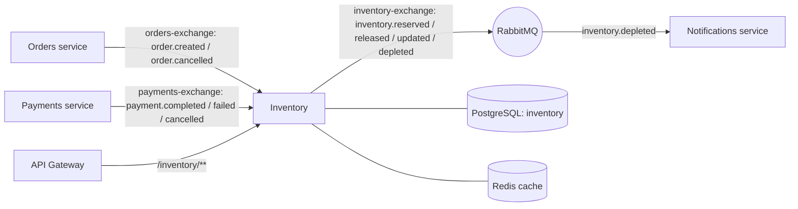
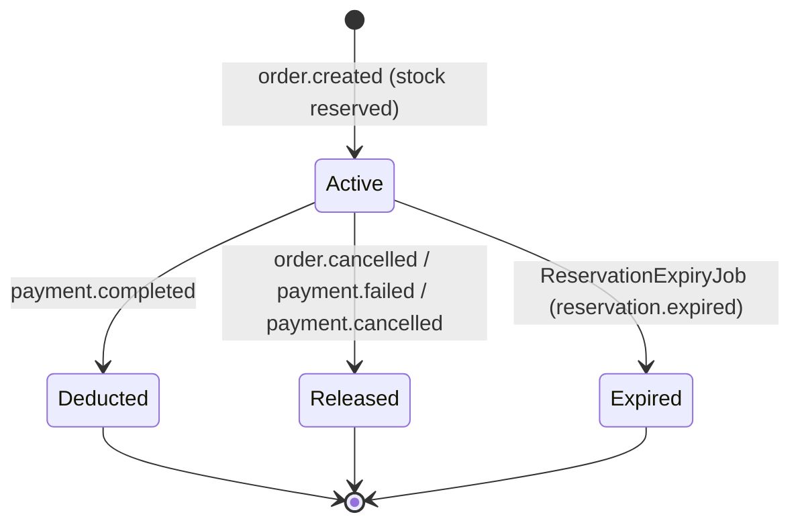

# Inventory Service

Stock-keeping microservice for the 3D-printing e-commerce platform. It owns the on-hand and reserved quantity of every product, reserves stock when an order is created, deducts it when the payment completes, and releases it when the order is cancelled, the payment fails or is cancelled, or the reservation times out.

- Runtime: ASP.NET Core minimal API on .NET 10, plus background workers (RabbitMQ consumers and a reservation-expiry job) in the same process.
- Datastores: PostgreSQL (source of truth) and Redis (read cache).
- Messaging: RabbitMQ (topic exchanges). Consumes `orders-exchange` and `payments-exchange`; publishes `inventory-exchange`.
- Container port: `8080`. Compose host port: `${INVENTORY_PORT}` (`5137` in `docker/template.env`).

## Contents

1. [Role in the system](#1-role-in-the-system)
2. [Tech stack](#2-tech-stack)
3. [Project layout](#3-project-layout)
4. [HTTP API](#4-http-api)
5. [Messaging](#5-messaging)
6. [Data storage](#6-data-storage)
7. [Domain model and business rules](#7-domain-model-and-business-rules)
8. [Configuration](#8-configuration)
9. [Observability](#9-observability)
10. [Running locally](#10-running-locally)
11. [Testing](#11-testing)
12. [Notes, caveats and known gaps](#12-notes-caveats-and-known-gaps)

---

## 1. Role in the system



| Related service | Relationship |
|-----------------|--------------|
| Orders | Publishes `order.created` (triggers reservation) and `order.cancelled` (triggers release) on `orders-exchange`. |
| Payments | Publishes `payment.completed` (triggers deduction), `payment.failed` and `payment.cancelled` (trigger release) on `payments-exchange`. |
| Notifications | Consumes `inventory.depleted` from `inventory-exchange` (the only Inventory event with a consumer found in this repository) and emails operators. |
| API Gateway | YARP route `/inventory/{**catch-all}` forwards to `http://inventory:8080` (`ApiGateway/ApiGateway/appsettings.json`). |
| Catalog | No direct integration. Inventory items are keyed by a product `Guid` and are created only by a manual stock adjustment. |

No other service in the repository consumes `inventory.reserved`, `inventory.released` or `inventory.updated`.

---

## 2. Tech stack

| Area | Technology (version from the `.csproj` files) |
|------|-----------------------------------------------|
| Runtime / SDK | .NET 10 (`net10.0`), C# with nullable reference types, ASP.NET Core minimal APIs |
| Docker images | `mcr.microsoft.com/dotnet/sdk:10.0` (build), `mcr.microsoft.com/dotnet/aspnet:10.0` (runtime) |
| CQRS / mediator | MediatR 13.0.0 (handlers plus a `LoggingBehavior` pipeline) |
| Persistence | EF Core 10.0.6, `Npgsql.EntityFrameworkCore.PostgreSQL` 10.0.1 |
| Cache | `StackExchange.Redis` 2.12.14 |
| Messaging | `RabbitMQ.Client` 7.2.1 (async API) |
| Health checks | `AspNetCore.HealthChecks.NpgSql` / `.Rabbitmq` / `.Redis` 9.0.0 |
| Observability | OpenTelemetry 1.15.x: OTLP exporter, ASP.NET Core, HttpClient, EF Core, StackExchange.Redis instrumentation |
| Tests | xUnit 2.9.3, FluentAssertions 8.9.0, Moq 4.20.72, Testcontainers 4.11.0 (PostgreSql, RabbitMq, Redis), `Microsoft.AspNetCore.Mvc.Testing` 10.0.6, `Microsoft.EntityFrameworkCore.Sqlite` 10.0.6 (referenced by UnitTests), coverlet |

`Microsoft.AspNetCore.OpenApi` is referenced, but no OpenAPI or Swagger endpoint is mapped.

---

## 3. Project layout

The solution is `Inventory.sln` and uses a layered (clean-architecture style) split. Dependencies point inward: `Inventory` (host) -> `Application`/`Infrastructure` -> `Domain`/`Contracts`.

```
Inventory/
├── Inventory.sln
├── .dockerignore
├── Inventory/                      # Host (web) project, entry point
│   ├── Program.cs                  # DI, middleware, health checks, route groups
│   ├── Endpoints/                  # Minimal-API endpoint mappings (3 endpoints)
│   ├── Middleware/                 # CorrelationId, RequestLogging, Exception
│   ├── appsettings.json            # Container defaults (hostnames: postgres, rabbitmq, redis, jaeger)
│   ├── appsettings.Development.json# Native-run defaults (localhost)
│   ├── Inventory.http              # Sample HTTP requests
│   └── Dockerfile
├── Application/                    # Use cases (MediatR) and abstractions
│   ├── Features/Inventory/         # Adjust, DeductStock, GetByProductId, List, ReleaseStock, ReserveStock
│   ├── Abstractions/               # ICacheService, IEventPublisher, IIdempotencyStore,
│   │                               # IInventoryRepository (+ITransactionScope, InventoryFilter), IReservationPolicy
│   ├── DTOs/                       # InventoryItemDto, InventoryListDto
│   ├── Common/LoggingBehavior.cs   # MediatR pipeline: logs request payload and duration
│   └── DependencyInjection/
├── Domain/                         # Pure domain model, no dependencies
│   ├── Entities/                   # InventoryItem, StockReservation, InventoryMovement, ProcessedIntegrationEvent
│   ├── Enums/                      # ReservationStatus, MovementType
│   └── Exceptions/                 # InventoryException hierarchy (with machine-readable codes)
├── Contracts/                      # Published event contracts + ActivitySource
│   └── Events/                     # InventoryReserved, InventoryReleased, InventoryUpdated, InventoryDepleted
├── Infrastructure/
│   ├── Persistence/                # InventoryDbContext, EF configurations, repositories, IdempotencyStore
│   ├── Inventory/Migrations/       # ACTIVE EF Core migrations (InitialCreateFirst + snapshot)
│   ├── Persistence/Migrations/     # Stale duplicate migration file (see section 12)
│   ├── Messaging/                  # RabbitMqPublisher, 5 consumers, ConsumerBase (unused)
│   ├── BackgroundJobs/             # ReservationExpiryJob
│   ├── Caching/                    # RedisCacheService
│   ├── Configuration/              # Options classes, ReservationPolicy
│   ├── Observability/              # OpenTelemetrySetup
│   └── DependencyInjection/
├── UnitTests/                      # Domain and handler tests (Moq)
└── IntegrationTests/               # End-to-end tests with Testcontainers
```

---

## 4. HTTP API

Base path: `/inventory`. Five endpoints plus `GET /health`.

**Authorization.** Reading one product's stock is open to everyone and returns only what a shopper may see (`available`, `inStock`). Every other endpoint (list, adjust, history, threshold) requires the `AdminOnly` policy, and an administrator calling `GET /inventory/{productId}` gets the full record. The gateway routes for the admin endpoints carry `AuthorizationPolicy: AdminOnly` as well.

JSON conventions: request and response bodies use ASP.NET Core web defaults (camelCase property names, case-insensitive on input). Enums are serialized as strings (`JsonStringEnumConverter`), but no HTTP payload currently contains an enum. Every response carries an `X-Correlation-Id` header (echoed from the request, or generated).

### 4.1 `GET /inventory/{productId}`

Returns the stock of one product.

| Item | Value |
|------|-------|
| Path param | `productId` (`Guid`, route constraint `:guid`) |
| Auth | Anyone. The body depends on the caller (see below) |
| Caching | Redis `inventory:product:{productId}`, TTL 5 min (the full record is cached; the shopper view is derived from it) |
| `200` | `PublicInventoryDto` for shoppers and anonymous callers, `InventoryItemDto` for administrators |
| `404` | Item does not exist (`inventory.not_found`) |

Shopper view:

```json
{ "productId": "1708aa1c-d853-4a67-a837-b073d7e42432", "available": 7, "inStock": true }
```

Administrator view:

```json
{
  "productId": "1708aa1c-d853-4a67-a837-b073d7e42432",
  "onHandQuantity": 10,
  "reservedQuantity": 3,
  "availableQuantity": 7,
  "isDepleted": false,
  "lowStockThreshold": 5,
  "status": "ok",
  "version": "AAAAAAAAB9E=",
  "updatedAt": "2026-06-04T10:15:30.1234567Z"
}
```

`availableQuantity = onHandQuantity - reservedQuantity`. `isDepleted` is `true` when `availableQuantity <= 0`. `status` is `out` when nothing is available, `low` when `0 < available <= lowStockThreshold`, otherwise `ok`. `version` changes with every update; send it back as `expectedVersion` to be told about concurrent changes.

### 4.2 `GET /inventory`

Paged list of inventory items, most urgent first: out of stock, then low, then the rest, each group by available quantity ascending.

| Query param | Type | Default | Behavior |
|-------------|------|---------|----------|
| `status` | `string?` | `all` | `all`, `low` (`0 < available <= threshold`) or `out` (`available <= 0`). |
| `productIds` | `string?` | none | Comma-separated product ids (at most 100); only those products are listed. |
| `depletedOnly` | `bool?` | `null` (no filter) | Legacy: `true` is the same as `status=out`. |
| `page` | `int?` | `1` | Values `<= 0` or missing fall back to `1`. |
| `pageSize` | `int?` | `20` | Values `<= 0` or missing fall back to `20`. Capped at `100`. |

| Item | Value |
|------|-------|
| Auth | `AdminOnly` |
| Caching | Redis `inventory:list:{SHA256-hex of filter JSON}`, TTL 1 min |
| `200` | `InventoryListDto` (items have the administrator shape of 4.1) |

```json
{
  "items": [
    {
      "productId": "1708aa1c-d853-4a67-a837-b073d7e42432",
      "onHandQuantity": 10,
      "reservedQuantity": 3,
      "availableQuantity": 7,
      "isDepleted": false,
      "lowStockThreshold": 5,
      "status": "ok",
      "version": "AAAAAAAAB9E=",
      "updatedAt": "2026-06-04T10:15:30.1234567Z"
    }
  ],
  "page": 1,
  "pageSize": 20,
  "totalCount": 1,
  "totalPages": 1
}
```

`totalPages = ceil(totalCount / pageSize)`.

### 4.3 `POST /inventory/{productId}/adjustments`

Manually changes stock, either by an amount or to an exact count. This is also the only way an inventory item is created.

| Item | Value |
|------|-------|
| Path param | `productId` (`Guid`) |
| Auth | `AdminOnly` |
| Request body | `AdjustInventoryRequest` |
| `200` | Updated `InventoryItemDto` (administrator shape of 4.1) |
| `400` | `validation_failed` with per-field `errors`: `mode` not `delta`/`set`, `reason` not 3 to 200 characters, `quantity` zero for `delta` or beyond 1,000,000 |
| `404` | `delta < 0` and the item does not exist |
| `409` | `stale_version`: `expectedVersion` no longer matches, or a concurrent change won |
| `422` | `below_zero` or `below_reserved`: the result would be negative or less than what open orders reserved |

```json
{
  "mode": "delta",
  "quantity": 50,
  "reason": "Delivery received from supplier",
  "expectedVersion": "AAAAAAAAB9E="
}
```

| Field | Type | Rules |
|-------|------|-------|
| `mode` | `string` | `delta` adds `quantity` (negative removes); `set` makes `quantity` the new on-hand count (`>= 0`). |
| `quantity` | `int` | Not `0` for `delta`; at most 1,000,000 in absolute value. |
| `reason` | `string` | Required, trimmed length 3 to 200. Stored in `InventoryMovements.Reason`. |
| `expectedVersion` | `string?` | The `version` the caller last read. When given and stale the change is refused with `409`. |

Behavior:

- Item missing and the result is `>= 0`: a new `InventoryItem` is created with that on-hand count and the default low-stock threshold (`Inventory:DefaultLowStockThreshold`, 5).
- Item exists: the change is applied, rejected if the result would be `< 0` or `< reserved`. The update is guarded by `RowVersion`, so two concurrent changes cannot both win.
- A movement (`Adjust`, with the admin's id and email and the resulting on-hand) and an audit entry (`inventory.adjust`) are written in the same transaction. Then the Redis cache is invalidated (`inventory:product:{id}` and the `inventory:list:` prefix) and `inventory.updated` is published, plus `inventory.depleted` if the item is now depleted. The Catalog service consumes `inventory.updated` to move a product between `Active` and `OutOfStock`.

### 4.3.1 `GET /inventory/{productId}/movements`

The stock history of one product, newest first (`AdminOnly`). Query: `page` (default 1), `pageSize` (default 20, at most 100). `404` when the product has no stock record.

```json
{
  "items": [
    {
      "id": "6f3f4b52-6a09-4d3c-a0a6-2d6b1b0f2f10",
      "occurredAt": "2026-06-04T10:15:30.1234567Z",
      "type": "Adjust",
      "delta": 50,
      "reason": "Delivery received from supplier",
      "actorId": "0b0c8f5e-4f2b-4c1d-9c53-1c0b2e7f9a11",
      "actor": "admin@example.com",
      "orderId": null,
      "resultingOnHand": 60,
      "reservedAfter": 3
    }
  ],
  "page": 1,
  "pageSize": 20,
  "totalCount": 1,
  "totalPages": 1
}
```

Changes made by the order flow (`Reserve`, `Release`, `Deduct`) have no actor and carry the `orderId`.

### 4.3.2 `PUT /inventory/{productId}/threshold`

Sets the number at or below which the product counts as low on stock (`AdminOnly`). Body `{ "lowStockThreshold": 10 }`, a whole number from 0 to 100,000 (`400 validation_failed` otherwise, `404` without a stock record). Returns the updated `InventoryItemDto`. An audit entry `inventory.threshold.set` is written.

### 4.4 `GET /health`

Mapped outside the `/inventory` group and not mapped when the environment is `Testing`. It returns `application/json`; the HTTP status is the ASP.NET Core default (`200` for Healthy or Degraded, `503` for Unhealthy).

```json
{
  "status": "Healthy",
  "checks": [
    { "name": "postgres", "status": "Healthy", "error": null },
    { "name": "redis", "status": "Healthy", "error": null },
    { "name": "rabbitmq", "status": "Healthy", "error": null }
  ]
}
```

The `redis` check is registered only when `Redis:ConnectionString` is non-empty.

### 4.5 Error format and status mapping

Errors are produced by `ExceptionMiddleware` as Problem Details (`application/problem+json`). `error` repeats `detail` for older callers; `errors` is present for field validation failures.

```json
{
  "type": "about:blank",
  "title": "Not Found",
  "status": 404,
  "detail": "Inventory item for product 1708aa1c-d853-4a67-a837-b073d7e42432 not found",
  "code": "inventory.not_found",
  "error": "Inventory item for product 1708aa1c-d853-4a67-a837-b073d7e42432 not found",
  "traceId": "0HN..."
}
```

| Exception | `code` | HTTP status |
|-----------|--------|-------------|
| `InventoryValidationException` | `validation_failed` | 400 (with `errors`) |
| `InventoryItemNotFoundException` | `inventory.not_found` | 404 |
| `InsufficientStockException` | `inventory.insufficient_stock` | 409 |
| `InvalidReservationStateException` | `inventory.invalid_reservation_state` | 409 |
| `InvalidAdjustmentException` | `below_zero`, `below_reserved` (or `inventory.invalid_adjustment`) | 422 |
| `ConcurrencyConflictException` | `stale_version` | 409 |
| `KeyNotFoundException` | `null` | 404 |
| `ArgumentException` | `null` | 400 |
| any other exception | `null` | 500 |

### 4.6 Sample requests

`Inventory/Inventory.http` contains ready-made requests (host `http://localhost:5000`):

```http
GET  /inventory/{productId}
GET  /inventory?page=1&pageSize=20
GET  /inventory?status=out&page=1&pageSize=20
POST /inventory/{productId}/adjustments   { "mode": "delta", "quantity": -5, "reason": "Damaged goods removed from warehouse" }
GET  /inventory/{productId}/movements
PUT  /inventory/{productId}/threshold     { "lowStockThreshold": 10 }
```

---

## 5. Messaging

All exchanges are **topic**, **durable**. The service declares every exchange it uses (consumers declare the source exchanges, the publisher declares `inventory-exchange`), so startup order relative to Orders and Payments does not matter.

### 5.1 Summary

| Direction | Exchange | Routing key | Queue (durable) | Handler / publisher | Effect |
|-----------|----------|-------------|-----------------|---------------------|--------|
| Consume | `orders-exchange` | `order.created` | `inventory.orders.created` | `OrderCreatedConsumer` | Reserve stock |
| Consume | `orders-exchange` | `order.cancelled` | `inventory.orders.cancelled` | `OrderCancelledConsumer` | Release stock (reason `order.cancelled`) |
| Consume | `payments-exchange` | `payment.completed` | `inventory.payments.completed` | `PaymentCompletedConsumer` | Deduct reserved stock |
| Consume | `payments-exchange` | `payment.failed` | `inventory.payments.failed` | `PaymentFailedConsumer` | Release stock (reason `payment.failed`) |
| Consume | `payments-exchange` | `payment.cancelled` | `inventory.payments.cancelled` | `PaymentCancelledConsumer` | Release stock (reason `payment.cancelled`) |
| Publish | `inventory-exchange` | `inventory.reserved` | none (no queue declared here) | `ReserveStockHandler` | Stock reserved for an order |
| Publish | `inventory-exchange` | `inventory.released` | none | `ReleaseStockHandler` | Reservations released or expired |
| Publish | `inventory-exchange` | `inventory.updated` | none | Adjust, Reserve, Deduct, Release handlers | Item quantities changed |
| Publish | `inventory-exchange` | `inventory.depleted` | none | Adjust, Reserve, Deduct handlers | Item has no available stock |

Queues are declared with `durable: true`, `exclusive: false`, `autoDelete: false` and no extra arguments.

### 5.2 Consumed events

Payloads are deserialized with `System.Text.Json` using `PropertyNameCaseInsensitive = true` into private DTOs inside each consumer. Extra fields sent by the producer (for example `RecipientEmail`) are ignored. Only the fields below are read.

#### `order.created` (`OrderCreatedConsumer`)

| Field | Type | Used |
|-------|------|------|
| `orderId` | `Guid` | Yes (reservation key, idempotency key) |
| `userId` | `Guid` | No |
| `totalAmount` | `decimal` | No |
| `currency` | `string?` | No |
| `itemCount` | `int` | No |
| `createdAt` | `DateTime` | No |
| `items` | `List<{ productId: Guid, quantity: int }>?` | Yes. Items with `quantity <= 0` are dropped. |

```json
{
  "orderId": "5b1c6a3e-0c53-4b4e-9d7a-2f4a3f0c9e11",
  "userId": "0a8f2d4c-6a43-4a1b-8f9e-77c5a1b1d001",
  "totalAmount": 100.00,
  "currency": "EUR",
  "itemCount": 1,
  "createdAt": "2026-06-04T10:15:30Z",
  "items": [
    { "productId": "1708aa1c-d853-4a67-a837-b073d7e42432", "quantity": 3 }
  ]
}
```

If no item with a positive quantity remains, nothing is reserved (an informational log) and the message is still marked processed and acked.

#### `order.cancelled` (`OrderCancelledConsumer`)

| Field | Type | Used |
|-------|------|------|
| `orderId` | `Guid` | Yes |
| `userId` | `Guid` | No |
| `reason` | `string?` | No (the release reason is the constant `order.cancelled`) |
| `cancelledAt` | `DateTime` | No |

```json
{
  "orderId": "5b1c6a3e-0c53-4b4e-9d7a-2f4a3f0c9e11",
  "userId": "0a8f2d4c-6a43-4a1b-8f9e-77c5a1b1d001",
  "reason": "Customer cancelled",
  "cancelledAt": "2026-06-04T10:20:00Z"
}
```

#### `payment.completed` (`PaymentCompletedConsumer`)

| Field | Type | Used |
|-------|------|------|
| `paymentId` | `Guid` | No |
| `orderId` | `Guid` | Yes |
| `userId` | `Guid` | No |
| `amount` | `decimal` | No |
| `currency` | `string?` | No |
| `providerPaymentId` | `string?` | No |
| `completedAt` | `DateTime` | No |

```json
{
  "paymentId": "c2f0b7f0-4c1d-4e0e-b0a6-9a9c8d7e6f50",
  "orderId": "5b1c6a3e-0c53-4b4e-9d7a-2f4a3f0c9e11",
  "userId": "0a8f2d4c-6a43-4a1b-8f9e-77c5a1b1d001",
  "amount": 100.00,
  "currency": "EUR",
  "providerPaymentId": "pi_test_123",
  "completedAt": "2026-06-04T10:16:10Z"
}
```

#### `payment.failed` (`PaymentFailedConsumer`)

| Field | Type | Used |
|-------|------|------|
| `paymentId` | `Guid` | No |
| `orderId` | `Guid` | Yes |
| `userId` | `Guid` | No |
| `amount` | `decimal` | No |
| `currency` | `string?` | No |
| `reason` | `string?` | No (release reason is the constant `payment.failed`) |
| `failedAt` | `DateTime` | No |

```json
{
  "paymentId": "c2f0b7f0-4c1d-4e0e-b0a6-9a9c8d7e6f50",
  "orderId": "5b1c6a3e-0c53-4b4e-9d7a-2f4a3f0c9e11",
  "userId": "0a8f2d4c-6a43-4a1b-8f9e-77c5a1b1d001",
  "amount": 100.00,
  "currency": "EUR",
  "reason": "Insufficient funds",
  "failedAt": "2026-06-04T10:16:10Z"
}
```

#### `payment.cancelled` (`PaymentCancelledConsumer`)

| Field | Type | Used |
|-------|------|------|
| `paymentId` | `Guid` | No |
| `orderId` | `Guid` | Yes |
| `userId` | `Guid` | No |
| `reason` | `string?` | No (release reason is the constant `payment.cancelled`) |
| `cancelledAt` | `DateTime` | No |

```json
{
  "paymentId": "c2f0b7f0-4c1d-4e0e-b0a6-9a9c8d7e6f50",
  "orderId": "5b1c6a3e-0c53-4b4e-9d7a-2f4a3f0c9e11",
  "userId": "0a8f2d4c-6a43-4a1b-8f9e-77c5a1b1d001",
  "reason": "Cancelled by user",
  "cancelledAt": "2026-06-04T10:17:00Z"
}
```

### 5.3 Consumer behavior

Every consumer follows the same flow (the five classes are near-identical copies):

1. On start (`BackgroundService.ExecuteAsync`) it creates its own channel on the shared singleton `IConnection`, declares the exchange, declares the durable queue, binds it with the routing key, and starts a consumer with `autoAck: false`.
2. Deserialize the body (UTF-8 JSON). If the result is `null`, log a warning and **ack** (the message is dropped).
3. Read `BasicProperties.CorrelationId` (may be `null`); it is passed to the command and stored in `InventoryMovements.CorrelationId`.
4. **Idempotency check:** look up `ProcessedIntegrationEvents` for `(ConsumerName, "<routingKey>:<orderId>")`. If present, log and **ack** without doing anything.
5. Send the MediatR command (`ReserveStockCommand`, `ReleaseStockCommand` or `DeductStockCommand`).
6. Add a `ProcessedIntegrationEvents` row and `SaveChanges`, then **ack**.
7. On any exception: log the error and **nack with `requeue: true`**.

| Consumer | Idempotency key | Command |
|----------|-----------------|---------|
| `OrderCreatedConsumer` | `order.created:{orderId}` | `ReserveStockCommand` |
| `OrderCancelledConsumer` | `order.cancelled:{orderId}` | `ReleaseStockCommand("order.cancelled")` |
| `PaymentCompletedConsumer` | `payment.completed:{orderId}` | `DeductStockCommand` |
| `PaymentFailedConsumer` | `payment.failed:{orderId}` | `ReleaseStockCommand("payment.failed")` |
| `PaymentCancelledConsumer` | `payment.cancelled:{orderId}` | `ReleaseStockCommand("payment.cancelled")` |

Reliability characteristics (as implemented):

- **Retry:** failed messages are requeued immediately and indefinitely. There is no retry counter, delay, dead-letter exchange, or poison-message handling. No `BasicQos` prefetch limit is set.
- **Idempotency is two-layered:** the `ProcessedIntegrationEvents` table (unique index on `ConsumerName, IdempotencyKey`) plus handler-level no-ops (see section 7). The marker is written after the business transaction has committed, in a separate `SaveChanges`. A crash in between leads to a redelivery that the handler-level idempotency absorbs.
- **Business outcomes that are not errors are still acked and marked processed:** insufficient stock on reserve (`success=false`), `no_reservation` and `terminal_not_active` on deduct, and `no_active_reservations` on release. They are only logged.
- **Outbound events are published after the DB commit with no outbox**, so a crash between commit and publish loses those events.
- `ConsumerBase<TMessage, TCommand>` is an abstract generic consumer base that is **not used** by any consumer.

### 5.4 Published events

`RabbitMqPublisher` (scoped `IEventPublisher`) serializes the contract with default `System.Text.Json` options, so **property names are PascalCase** in the wire JSON (unlike the HTTP API). `DateTime` values are UTC (`...Z`). For every publish it opens a new channel, redeclares `inventory-exchange` (topic, durable), and calls `BasicPublishAsync` with `mandatory: false` and no message properties (no correlation id, no explicit persistent delivery mode). It records an `rabbitmq.publish` span (see section 9).

Contracts live in `Contracts/Events/`.

#### `inventory.reserved` (`InventoryReserved`)

Published once per successful reservation (all lines of an order).

| Field | Type | Notes |
|-------|------|-------|
| `OrderId` | `Guid` | |
| `ReservedAt` | `DateTime` | `DateTime.UtcNow` at publish time |
| `Lines` | `List<InventoryReservedLine>` | `{ ProductId: Guid, Quantity: int }` as requested |

```json
{
  "OrderId": "5b1c6a3e-0c53-4b4e-9d7a-2f4a3f0c9e11",
  "ReservedAt": "2026-06-04T10:15:31.2345678Z",
  "Lines": [
    { "ProductId": "1708aa1c-d853-4a67-a837-b073d7e42432", "Quantity": 3 }
  ]
}
```

#### `inventory.released` (`InventoryReleased`)

Published when at least one active reservation was released.

| Field | Type | Notes |
|-------|------|-------|
| `OrderId` | `Guid` | |
| `Reason` | `string` | `order.cancelled`, `payment.failed`, `payment.cancelled` or `reservation.expired` |
| `ReleasedAt` | `DateTime` | UTC |
| `Lines` | `List<InventoryReleasedLine>` | `{ ProductId: Guid, Quantity: int }` for each reservation released |

```json
{
  "OrderId": "5b1c6a3e-0c53-4b4e-9d7a-2f4a3f0c9e11",
  "Reason": "payment.failed",
  "ReleasedAt": "2026-06-04T10:16:11.1111111Z",
  "Lines": [
    { "ProductId": "1708aa1c-d853-4a67-a837-b073d7e42432", "Quantity": 3 }
  ]
}
```

#### `inventory.updated` (`InventoryUpdated`)

Published whenever the quantities of an item are observed or changed by a use case.

| Field | Type |
|-------|------|
| `ProductId` | `Guid` |
| `OnHandQuantity` | `int` |
| `ReservedQuantity` | `int` |
| `AvailableQuantity` | `int` |
| `UpdatedAt` | `DateTime` |

```json
{
  "ProductId": "1708aa1c-d853-4a67-a837-b073d7e42432",
  "OnHandQuantity": 10,
  "ReservedQuantity": 3,
  "AvailableQuantity": 7,
  "UpdatedAt": "2026-06-04T10:15:31.2000000Z"
}
```

Published by:

| Use case | When |
|----------|------|
| Adjust | Every successful adjustment |
| Reserve | After a successful reservation (one per product); **also** for every existing product when a reservation is rejected for insufficient stock (current values, nothing changed) |
| Deduct | One per product after deduction |
| Release | One per product (items that exist) after release |

#### `inventory.depleted` (`InventoryDepleted`)

Published after Adjust, Reserve (success) and Deduct when `AvailableQuantity <= 0`. It is **not** a transition event: it is emitted every time one of these operations leaves the item depleted. It is not published by the Release path (release only increases available stock).

| Field | Type |
|-------|------|
| `ProductId` | `Guid` |
| `DepletedAt` | `DateTime` (the item's `UpdatedAt`) |

```json
{
  "ProductId": "1708aa1c-d853-4a67-a837-b073d7e42432",
  "DepletedAt": "2026-06-04T10:16:40.5000000Z"
}
```

The Notifications service consumes this event (`InventoryDepletedHandler`) and emails the addresses in `NOTIFICATIONS_OPERATOR_EMAILS`.

---

## 6. Data storage

### 6.1 PostgreSQL

Database name: `inventory`. Provider: Npgsql. Table and column names are the EF defaults (PascalCase, quoted identifiers). All timestamps are `timestamp with time zone` and are written as UTC. Enums are stored as integers (no value converter is configured).

The schema is defined by `Infrastructure/Persistence/Configurations/*` and created by the migration `20260604055841_InitialCreateFirst` in `Infrastructure/Inventory/Migrations/`.

#### `InventoryItems`

One row per product.

| Column | Type | Null | Notes |
|--------|------|------|-------|
| `Id` | `uuid` | no | PK (`PK_InventoryItems`) |
| `ProductId` | `uuid` | no | Unique index `IX_InventoryItems_ProductId` |
| `OnHandQuantity` | `integer` | no | Physical stock |
| `ReservedQuantity` | `integer` | no | Stock held by active reservations |
| `RowVersion` | `bytea` | no | Optimistic-concurrency token. The application replaces it with a new `Guid` (16 bytes) on every mutation. |
| `CreatedAt` | `timestamp with time zone` | no | |
| `UpdatedAt` | `timestamp with time zone` | no | |

`AvailableQuantity` and `IsDepleted` are computed in code and are not stored. There are no CHECK constraints; non-negativity is enforced in the domain methods.

#### `StockReservations`

One row per order line (product) that has been reserved.

| Column | Type | Null | Notes |
|--------|------|------|-------|
| `Id` | `uuid` | no | PK |
| `OrderId` | `uuid` | no | Index `IX_StockReservations_OrderId` |
| `OrderLineId` | `uuid` | yes | Never populated by current code |
| `ProductId` | `uuid` | no | Index `IX_StockReservations_ProductId` |
| `Quantity` | `integer` | no | |
| `Status` | `integer` | no | `ReservationStatus`: `0` Active, `1` Released, `2` Expired, `3` Deducted |
| `ExpiresAt` | `timestamp with time zone` | no | `now + ReservationTimeoutMinutes` at creation. Composite index `IX_StockReservations_Status_ExpiresAt` (`Status`, `ExpiresAt`) |
| `CreatedAt` | `timestamp with time zone` | no | |
| `FinalizedAt` | `timestamp with time zone` | yes | Set on any transition out of Active |

There is no foreign key to `InventoryItems` and no unique constraint on `(OrderId, ProductId)`.

#### `InventoryMovements`

Append-only ledger of every stock change.

| Column | Type | Null | Notes |
|--------|------|------|-------|
| `Id` | `uuid` | no | PK |
| `ProductId` | `uuid` | no | Composite index `IX_InventoryMovements_ProductId_OccurredAt` (`ProductId`, `OccurredAt`) |
| `OrderId` | `uuid` | yes | Index `IX_InventoryMovements_OrderId` |
| `ReservationId` | `uuid` | yes | |
| `MovementType` | `integer` | no | `0` Reserve, `1` Release, `2` Deduct, `3` Adjust |
| `QuantityDelta` | `integer` | no | See table below |
| `OnHandAfter` | `integer` | no | Snapshot after the change |
| `ReservedAfter` | `integer` | no | Snapshot after the change |
| `SourceTrigger` | `varchar(100)` | no | What caused it (see table below) |
| `Reason` | `varchar(500)` | yes | Free-text reason (only set by manual adjustments) |
| `CorrelationId` | `varchar(100)` | yes | From the RabbitMQ `correlation_id` property, when present |
| `OccurredAt` | `timestamp with time zone` | no | |

| `MovementType` | `QuantityDelta` | `SourceTrigger` values |
|----------------|-----------------|------------------------|
| `Reserve` | `+quantity` (reserved amount) | `order.created` |
| `Release` | `-quantity` (reserved amount released) | `order.cancelled`, `payment.failed`, `payment.cancelled`, `reservation.expired` |
| `Deduct` | `-quantity` (on-hand amount removed) | `payment.completed` |
| `Adjust` | signed `delta` | `manual.adjust` |

#### `ProcessedIntegrationEvents`

Consumer idempotency log.

| Column | Type | Null | Notes |
|--------|------|------|-------|
| `Id` | `uuid` | no | PK |
| `ConsumerName` | `varchar(200)` | no | For example `OrderCreatedConsumer` |
| `IdempotencyKey` | `varchar(200)` | no | For example `order.created:<orderId>` |
| `ProcessedAt` | `timestamp with time zone` | no | |

Unique index `IX_ProcessedIntegrationEvents_ConsumerName_IdempotencyKey` (`ConsumerName`, `IdempotencyKey`). Rows are never purged.

#### Migrations

- Migrations are applied automatically on startup **only when `ASPNETCORE_ENVIRONMENT=Development`** (`db.Database.Migrate()` in `Program.cs`). `Migrate()` also creates the `inventory` database if it does not exist. The compose file sets `Development` for the service, so the container migrates itself. Nothing migrates in other environments, and the integration-test factory migrates explicitly.
- Add a migration (from the `Inventory/` solution folder; it needs `Microsoft.EntityFrameworkCore.Design`, already referenced):

```bash
dotnet ef migrations add <Name> --project Infrastructure --startup-project Inventory --output-dir Inventory/Migrations
```

The existing migration's namespace is `Infrastructure.Inventory.Migrations`, so the `--output-dir` above keeps new migrations next to it. Without it, EF would use its default `Migrations` folder.

### 6.2 Redis

Used only as a read cache (via `RedisCacheService : ICacheService`). The cache is not a source of truth, and the service writes no other Redis data.

| Key | Value | TTL | Written by | Invalidated by |
|-----|-------|-----|------------|----------------|
| `inventory:product:{productId}` | JSON of `InventoryItemDto` (PascalCase property names, default `System.Text.Json`) | 5 minutes | `GetInventoryByProductIdHandler` | Adjust, Reserve (success), Deduct, Release: `DEL` of the product key |
| `inventory:list:{hash}` | JSON of `InventoryListDto`. `{hash}` is the upper-case hex SHA-256 of the serialized `InventoryFilter`, for example `{"DepletedOnly":null,"Page":1,"PageSize":20}` | 1 minute | `ListInventoryHandler` | Adjust, Reserve (success), Deduct, Release: all keys matching `inventory:list:*` (enumerated with `IServer.Keys` on the first endpoint, then deleted one by one) |

Notes:

- `RedisOptions.DefaultTtlSeconds` (default `300`) applies only when a caller passes no TTL; both current callers pass an explicit TTL.
- If a reservation is rejected for insufficient stock, no cache entries are invalidated (nothing changed).
- Redis connection options: `AbortOnConnectFail = false`, `ConnectRetry = 10`.
- The cache service is registered **only if `Redis:ConnectionString` is non-empty**. The handlers require `ICacheService`, so an empty value makes request and consumer handling fail at DI resolution. Treat Redis as required.

---

## 7. Domain model and business rules

### 7.1 Aggregates and quantities

`InventoryItem` (per product):

- `OnHandQuantity`: physical units. `ReservedQuantity`: units promised to orders. `AvailableQuantity = OnHand - Reserved`. `IsDepleted = Available <= 0`.
- Every mutation updates `UpdatedAt` and generates a new `RowVersion`, which EF uses as a concurrency token. A concurrent update causes `DbUpdateConcurrencyException`, which the repository converts into `ConcurrencyConflictException`.

| Operation | Rule | Violation |
|-----------|------|-----------|
| `Reserve(q)` | `q > 0` and `q <= Available`; `Reserved += q` | `InvalidReservationStateException` / `InsufficientStockException` |
| `Release(q)` | `q > 0` and `q <= Reserved`; `Reserved -= q` | `InvalidReservationStateException` |
| `Deduct(q)` | `q > 0`, `q <= Reserved`, `q <= OnHand`; `Reserved -= q` and `OnHand -= q` | `InvalidReservationStateException` |
| `Adjust(delta)` | `OnHand + delta >= 0` and `>= Reserved`; `OnHand += delta` | `InvalidAdjustmentException` |
| constructor | `initialOnHand >= 0` | `InvalidAdjustmentException` |

### 7.2 Reservation state machine

`StockReservation.Status` starts as `Active`. The only allowed transitions are from `Active` to a terminal state; any other transition throws `InvalidReservationStateException`.



### 7.3 Use cases (MediatR handlers)

**ReserveStock** (`order.created`)

1. No lines: returns `no_lines`.
2. If the order already has any reservation in `Active` or `Deducted`, it is a no-op and returns success with reason `duplicate`. Orders whose reservations are only `Released`/`Expired` can be reserved again.
3. In a DB transaction, load items for all product ids. If **any** line has no inventory item or insufficient availability, the whole order is rejected (`insufficient_stock`, nothing is reserved), the transaction is rolled back, `inventory.updated` is published for the existing items, and no `inventory.reserved` is published. Nothing is sent back to the Orders service about the failure.
4. Otherwise, for each line: `item.Reserve(q)`, a `StockReservation` is created (`ExpiresAt = UtcNow + ReservationTimeoutMinutes`, same expiry for all lines), and a `Reserve` movement is recorded. After commit, it publishes `inventory.reserved`, then per product `inventory.updated` (+ `inventory.depleted` if applicable) and invalidates the cache.
5. `ConcurrencyConflictException` is retried up to **3 attempts** in total, and then rethrown (the consumer nacks and requeues).

**DeductStock** (`payment.completed`)

- No reservations for the order: logs a warning and returns `no_reservation` (nothing deducted).
- No `Active` reservations: if all are `Deducted`, returns success `already_deducted`. Otherwise returns `terminal_not_active` (for example when they were already `Released` or `Expired`) and does nothing.
- Otherwise, in one transaction, for each active reservation: `item.Deduct(q)`, `reservation.Deduct()`, and a `Deduct` movement. Then it publishes `inventory.updated` per product (+ `inventory.depleted` if applicable) and invalidates the cache.

**ReleaseStock** (`order.cancelled`, `payment.failed`, `payment.cancelled`, expiry job)

- No `Active` reservations: success with note `no_active_reservations` (idempotent no-op, nothing published).
- Otherwise, in one transaction, for each active reservation: `item.Release(q)`, `reservation.Release()` (or `Expire()` when `MarkExpired = true`), and a `Release` movement with `SourceTrigger = reason`. If the inventory item no longer exists, only the reservation is moved to a terminal state (warning logged).
- Publishes one `inventory.released` for the order, then `inventory.updated` per product, and invalidates the cache.

**AdjustInventory** (HTTP) - see section 4.3.

**GetInventoryByProductId / ListInventory** - cache-aside reads, see section 6.2.

### 7.4 Background job: `ReservationExpiryJob`

A hosted `BackgroundService` that runs in the same process as the API.

- Runs once immediately at startup, then every `Inventory:ExpiryJobIntervalSeconds` (default 60 s). Each iteration is wrapped in a try/catch that logs errors.
- Loads up to `Inventory:ExpiryJobBatchSize` (default 100) reservations with `Status = Active` and `ExpiresAt <= UtcNow`, oldest first (uses the `Status, ExpiresAt` index).
- For each distinct `OrderId`, sends `ReleaseStockCommand(Reason: "reservation.expired", CorrelationId: null, MarkExpired: true)`. The release is order-wide, so all of that order's active reservations are released and marked `Expired`. Failures for one order are logged and do not stop the others.
- Resulting events: `inventory.released` with `Reason = "reservation.expired"` and `inventory.updated` per product.
- There is no distributed lock. Multiple instances are safe because releases are idempotent and guarded by optimistic concurrency, but they may do duplicate work or log conflicts.

---

## 8. Configuration

Configuration uses standard ASP.NET Core sources (`appsettings.json`, `appsettings.{Environment}.json`, environment variables with `__` as the section separator, for example `Database__ConnectionString`).

| Key / environment variable | Default (`appsettings.json`) | `appsettings.Development.json` | Description |
|----------------------------|------------------------------|--------------------------------|-------------|
| `ServiceName` | `inventory-service` | same | OpenTelemetry `service.name` for traces. |
| `OTEL_EXPORTER_OTLP_ENDPOINT` | `http://jaeger:4317` | `http://localhost:4317` | OTLP gRPC endpoint for traces and logs. Read as a plain configuration key. |
| `Database__ConnectionString` | `Host=postgres;Port=5432;Database=inventory;Username=postgres;Password=postgres` | `Host=localhost;Port=5433;Database=inventory;Username=postgres;Password=postgres` | Npgsql connection string. Also used by the health check. Example credentials only. |
| `RabbitMQ__Host` | `rabbitmq` | `localhost` | Broker host. |
| `RabbitMQ__Port` | `5672` | `5672` | AMQP port (class default `5672`). |
| `RabbitMQ__Username` | `guest` | `guest` | Broker user (example default). |
| `RabbitMQ__Password` | `guest` | `guest` | Broker password (example default). |
| `RabbitMQ__VirtualHost` | `/` | `/` | Virtual host (class default `/`). |
| `Redis__ConnectionString` | `redis:6379` | `localhost:6379` | StackExchange.Redis configuration string. Effectively required (see 6.2). |
| `Redis__DefaultTtlSeconds` | not in file (class default `300`) | not in file | Fallback cache TTL. |
| `Inventory__ReservationTimeoutMinutes` | `30` | `30` | Lifetime of a reservation before the expiry job releases it. |
| `Inventory__ExpiryJobIntervalSeconds` | `60` | `60` | Pause between expiry job runs. |
| `Inventory__ExpiryJobBatchSize` | not in file (class default `100`) | not in file | Max reservations loaded per expiry run. |
| `ASPNETCORE_ENVIRONMENT` | n/a | n/a | `Development` enables startup migrations. `Testing` disables health checks and migration (used by integration tests). |
| `ASPNETCORE_URLS` | n/a (image default `8080`) | n/a | Compose sets `http://+:8080`. |

Docker Compose (`docker/docker-compose.yml`, service `inventory`) passes these values from `docker/.env` (copy `docker/template.env`):

| `.env` variable | Template value | Maps to |
|-----------------|----------------|---------|
| `INVENTORY_PORT` | `5137` | Host port, mapped to container `8080` |
| `INVENTORY_RESERVATION_TIMEOUT_MINUTES` | `30` | `Inventory__ReservationTimeoutMinutes` |
| `INVENTORY_EXPIRY_JOB_INTERVAL_SECONDS` | `60` | `Inventory__ExpiryJobIntervalSeconds` |
| `POSTGRES_USER`, `POSTGRES_PASSWORD` | `postgres` / `postgres` | Used in `Database__ConnectionString` (database `inventory`) |
| `RABBITMQ_USER`, `RABBITMQ_PASSWORD` | empty in the template (set your own) | `RabbitMQ__Username`, `RabbitMQ__Password` |

Compose also sets `RabbitMQ__Host=rabbitmq`, `Redis__ConnectionString=redis:6379` and `OTEL_EXPORTER_OTLP_ENDPOINT=http://jaeger:4317`. Do not commit real credentials; the values above in the appsettings files are local-development defaults only.

---

## 9. Observability

| Aspect | Implementation |
|--------|----------------|
| Tracing | OpenTelemetry (`Infrastructure/Observability/OpenTelemetrySetup.cs`), resource `service.name = ServiceName`. Instrumentation: ASP.NET Core and HttpClient (with `RecordException`), EF Core, StackExchange.Redis, and the custom `ActivitySource` `Inventory.Messaging`. Exported with OTLP (gRPC) to `OTEL_EXPORTER_OTLP_ENDPOINT` (Jaeger in compose; UI at `http://localhost:${OTEL_UI_PORT}`, `16686` by default). |
| Messaging spans | Only publishing creates a span (`rabbitmq.publish`, tags `messaging.system=rabbitmq`, `messaging.destination=<routing key>`). Consumers do not create spans or extract trace context, and published messages carry no trace headers. |
| Metrics | None configured. |
| Logging | Console provider plus the OpenTelemetry logging provider (OTLP export, scopes and formatted message included). The default providers are cleared. `LoggingBehavior` logs each MediatR request with its serialized payload and its duration. `RequestLoggingMiddleware` logs `HTTP {Method} {Path} responded {StatusCode} in {ElapsedMs}ms`. |
| Correlation id | `CorrelationIdMiddleware` reads `X-Correlation-Id` from the request or generates a `Guid`, stores it in `HttpContext.Items` and echoes it in the response header. It is not added to log scopes and is not propagated to published events. For messages, the AMQP `correlation_id` property is read by the consumers and persisted in `InventoryMovements.CorrelationId`. |
| Health | `GET /health` (Postgres, Redis, RabbitMQ), see section 4.4. |

---

## 10. Running locally

### 10.1 Docker Compose (whole platform)

From the repository root:

```bash
cd docker
cp template.env .env        # PowerShell: Copy-Item template.env .env ; then fill in RabbitMQ credentials etc.
docker compose up -d --build inventory
```

Compose starts the dependencies listed in `depends_on` (`postgres`, `rabbitmq`, `redis`, `jaeger`) and builds the image from `Inventory/` using `Inventory/Inventory/Dockerfile`. The `inventory` database is created by the service on startup (EF `Migrate()` in `Development`); the Postgres init script only creates `notifications`.

| Where | Address |
|-------|---------|
| Service (host) | `http://localhost:5137` (`${INVENTORY_PORT}`) |
| Service (container network) | `http://inventory:8080` |
| Through the gateway | `http://localhost:${GATEWAY_PORT}/inventory/...` (`5133` by default) |
| Health | `http://localhost:5137/health` |
| RabbitMQ UI | `http://localhost:${RABBITMQ_UI_PORT}` (`15672`) |
| Jaeger UI | `http://localhost:${OTEL_UI_PORT}` (`16686`) |

Note that the `postgres` service is published on host port `${POSTGRES_PORT}` (`5433` in the template), which matches `appsettings.Development.json`.

### 10.2 Native (`dotnet run`)

Prerequisites: .NET 10 SDK, and PostgreSQL (`localhost:5433`), RabbitMQ (`localhost:5672`) and Redis (`localhost:6379`) reachable with the values in `appsettings.Development.json`. The simplest way is to start only the infrastructure from compose:

```bash
cd docker
docker compose up -d postgres rabbitmq redis jaeger
cd ../Inventory
$env:ASPNETCORE_ENVIRONMENT = "Development"        # PowerShell; use `export` in bash
dotnet run --project Inventory
```

There is no `launchSettings.json`, so Kestrel uses its default URL (`http://localhost:5000`), which is what `Inventory.http` assumes. Set `ASPNETCORE_URLS` to change it. With `Development`, migrations run at startup and the OTLP endpoint is `http://localhost:4317`. In any other environment the connection strings in `appsettings.json` point at container hostnames, so override them with environment variables, and apply migrations yourself (`dotnet ef database update --project Infrastructure --startup-project Inventory`).

Seed stock for a product (nothing creates inventory items automatically):

```bash
curl -X POST http://localhost:5000/inventory/<productId>/adjustments \
  -H "Content-Type: application/json" \
  -d '{"delta": 50, "reason": "Initial stock"}'
```

### 10.3 Docker image

`Inventory/Inventory/Dockerfile` is a multi-stage build (SDK 10.0 restore/build/publish, ASP.NET 10.0 runtime), `EXPOSE 8080`, entry point `dotnet Inventory.dll`. The build context must be the `Inventory/` folder (as compose does with `context: ../Inventory`, `dockerfile: Inventory/Dockerfile`).

---

## 11. Testing

From the `Inventory/` folder:

```bash
dotnet test                              # everything
dotnet test UnitTests                    # fast, no external dependencies
dotnet test IntegrationTests             # requires Docker
```

| Project | Scope | Needs |
|---------|-------|-------|
| `UnitTests` | `InventoryItemTests` (domain invariants, `RowVersion` changes, depletion), and handler tests for `ReserveStock` (all-or-nothing, duplicate no-op, `InventoryDepleted`), `DeductStock` (deduct, already deducted, missing reservation), `ReleaseStock` (release + events, duplicate no-op, `MarkExpired`) and the expiry release path. The handlers use Moq mocks for `IInventoryRepository`, `IEventPublisher`, `ICacheService` and a `FakeTransactionScope`. | Nothing external |
| `IntegrationTests` | `InventoryApiFactory` (`WebApplicationFactory<Program>`) starts Testcontainers for **PostgreSQL 17**, **Redis 7** and **RabbitMQ 3-management**, runs `Database.Migrate()`, and hosts the real service in the `Testing` environment (health checks and startup migration disabled). `ReserveStockFlowTests` and `StockLifecycleFlowTests` seed stock through `POST /inventory/{id}/adjustments`, publish `order.created`, `order.cancelled`, `payment.completed` and `payment.failed` to RabbitMQ, and poll `GET /inventory/{id}` for the resulting quantities. | A running Docker daemon and the ability to pull images |

The integration tests do not cover `payment.cancelled`, the expiry job, idempotent redelivery or published events.

---

## 12. Notes, caveats and known gaps

Security

- No authentication or authorization in the service (section 4). The adjustment endpoint is effectively unprotected unless something in front of it restricts access.
- Default `guest/guest` and `postgres/postgres` values in `appsettings*.json` are for local development only. Supply real credentials through environment variables or `docker/.env` (git-ignored).

Reliability and consistency

- No transactional outbox: events are published after the database commit and a failure at that point loses them. The publish failure, in turn, makes the consumer nack and requeue.
- Consumers requeue failed messages forever (no dead-letter queue, retry limit or back-off).
- A rejected reservation (`insufficient_stock`) is only logged. There is no `inventory.reservation_failed` event, so the Orders service is never told. The rejected message is still acked and marked processed.
- `payment.completed` for an order whose reservation is already `Expired` or `Released` results in `terminal_not_active` and nothing is deducted. Likewise `payment.completed` before the reservation exists yields `no_reservation`, and the event is marked processed, so a later redelivery will not retry it.
- `ConcurrencyConflictException` maps to HTTP 400 in `ExceptionMiddleware` (it has no explicit case), although it is a conflict.
- The reservation retry loop reuses the same scoped `DbContext` after a failed `SaveChanges`, so tracked entities may be stale on the retry.
- `ReserveStockHandler` checks availability per line, so repeated lines for the same product in one order are not summed before the check (the second `Reserve` would throw).
- `inventory.depleted` is emitted on every qualifying operation, not only on the transition to depleted. Adjusting a new product by `0` creates an item and emits `inventory.depleted`.
- `RemoveByPrefixAsync` enumerates keys on the first Redis endpoint and deletes them one by one. This is fine for a small keyspace, but it does not scale to large ones or to clustered setups.
- Malformed JSON or parameter-binding errors raise `BadHttpRequestException` (when the environment is `Development`), which `ExceptionMiddleware` does not handle specifically, so it may be reported as `500`.
- `ProcessedIntegrationEvents` and `InventoryMovements` grow without bound (no retention job).

Code and documentation inconsistencies

- **Duplicate migrations:** `Infrastructure/Persistence/Migrations/20260528120000_InitialInventory.cs` has no `[Migration]` or `[DbContext]` attributes and no designer file, so EF does not discover it. Only `Infrastructure/Inventory/Migrations/20260604055841_InitialCreateFirst` (with snapshot) is active. `Infrastructure.csproj` also keeps an empty `<Folder Include="Persistence\Migrations\" />`.
- `ConsumerBase<TMessage, TCommand>` is unused; the five consumers duplicate its logic.
- `StockReservation.OrderLineId` exists but is never set.
- `Microsoft.AspNetCore.OpenApi`, `AspNetCore.HealthChecks.UI.Client` and the `AddEndpointsApiExplorer()` call are present, but no OpenAPI/Swagger document or health UI is exposed.
- `Inventory.sln` groups projects into virtual solution folders `src` and `tests`; the directories on disk are flat.
- There is no `specs/` folder in this project; this README is derived from the code.
