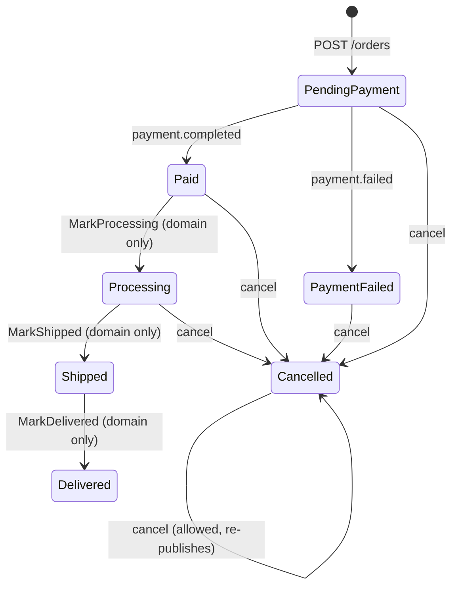

# Orders Service

ASP.NET Core (.NET 10) microservice that owns the **order lifecycle** of the 3D-printing e-commerce platform: it creates orders from a cart snapshot, stores them in PostgreSQL, serves order queries (cached in Redis), reacts to payment results coming from the Payments service over RabbitMQ, and publishes order domain events that other services (Inventory, Notifications, ...) consume.

- Service name (OpenTelemetry resource): `orders-service`
- Container port: `8080` (HTTP). Host port in Docker Compose: `${ORDERS_PORT}` (`5136` in `docker/template.env`). Native `dotnet run`: `http://localhost:5073` / `https://localhost:7087`.
- The service has **no authentication/authorization code of its own** (see [Security](#11-security-idempotency-and-known-gaps)). It is intended to be reached through the API Gateway (`/orders/{**catch-all}` route to `http://orders:8080`).

---

## Table of contents

1. [Purpose and role in the system](#1-purpose-and-role-in-the-system)
2. [Tech stack](#2-tech-stack)
3. [Architecture and project layout](#3-architecture-and-project-layout)
4. [HTTP API](#4-http-api)
5. [Messaging (RabbitMQ)](#5-messaging-rabbitmq)
6. [Data storage](#6-data-storage)
7. [Domain model and order state machine](#7-domain-model-and-order-state-machine)
8. [Configuration](#8-configuration)
9. [Observability](#9-observability)
10. [Running locally and tests](#10-running-locally-and-tests)
11. [Security, idempotency, and known gaps](#11-security-idempotency-and-known-gaps)

---

## 1. Purpose and role in the system

| Responsibility | Details |
|---|---|
| Create orders | `POST /orders` persists an order with its items and shipping address in status `PendingPayment`, then publishes `order.created`. |
| Query orders | Get by id, list for one user, or admin-style filtered/paginated list. Results are cached in Redis. |
| Cancel / edit | Cancel an order (publishes `order.cancelled`); update the shipping address while the order is `PendingPayment` or `Paid`. |
| React to payments | Consumes `payment.completed` (-> `Paid`, publishes `order.paid`) and `payment.failed` (-> `PaymentFailed`, publishes `order.payment_failed`) from the Payments service. |

### Relationships with other services

| Service | Direction | How |
|---|---|---|
| **API Gateway** (YARP) | Inbound HTTP | Gateway routes `/orders/**` to `http://orders:8080`. A gateway request transform copies the authenticated user's email claim (`ClaimTypes.Email` or JWT `email`) into the `X-User-Email` header, which Orders uses as the order's recipient email. |
| **Payments** | Inbound events | Orders consumes `payment.completed` and `payment.failed` from exchange `payments-exchange`. |
| **Inventory** | Outbound events | Inventory binds to `orders-exchange` for `order.created` (reserve stock) and `order.cancelled` (release stock). |
| **Notifications** (Python) | Outbound events | Notifications binds to `orders-exchange` and has handlers for `order.created`, `order.cancelled`, `order.shipped`, `order.delivered`, `order.payment_failed`; it relies on `RecipientEmail` in the payload. |
| **PdfWorker** | Inbound HTTP (configured) | `docker-compose.yml` gives PdfWorker `Orders__BaseUrl: http://orders:8080` (it depends on `orders`). |
| **Jaeger** | Outbound OTLP | Traces and logs are exported over OTLP gRPC (`:4317`). |

---

## 2. Tech stack

| Area | Technology |
|---|---|
| Language / runtime | C# / .NET `net10.0` (all projects), nullable reference types enabled |
| Web | ASP.NET Core Minimal APIs (`Microsoft.NET.Sdk.Web`) |
| CQRS / mediator | `MediatR` 13.0.0 (with a `LoggingBehavior` pipeline behavior) |
| Persistence | `Microsoft.EntityFrameworkCore` 10.0.6, `Npgsql.EntityFrameworkCore.PostgreSQL` 10.0.1 (PostgreSQL 17 in Compose) |
| Cache | `StackExchange.Redis` 2.12.14 |
| Messaging | `RabbitMQ.Client` 7.2.1 (async API) |
| Observability | `OpenTelemetry.Extensions.Hosting` 1.15.3, `OpenTelemetry.Exporter.OpenTelemetryProtocol` 1.15.3, instrumentation for ASP.NET Core (1.15.2), HttpClient (1.15.1), EF Core (1.15.1-beta.1), StackExchange.Redis (1.15.1-beta.1) |
| Health checks | `AspNetCore.HealthChecks.NpgSql` / `.Rabbitmq` / `.Redis` 9.0.0 |
| Other | `Microsoft.AspNetCore.OpenApi` 10.0.3 is referenced, but no OpenAPI document or Swagger UI is mapped in `Program.cs`. |
| Tests | xUnit 2.9.3, FluentAssertions 8.9.0, Moq 4.20.72, EF Core SQLite (unit), `Microsoft.AspNetCore.Mvc.Testing` + Testcontainers 4.11.0 (PostgreSql, RabbitMq, Redis) (integration) |

---

## 3. Architecture and project layout

Clean-architecture style solution (`Orders.sln`), with a MediatR command/query per use case.

```
Orders/
├── Orders.sln
├── Orders/                     # Web host (composition root)
│   ├── Program.cs              # DI, middleware, health checks, route group "/orders"
│   ├── Endpoints/              # One static class per endpoint (+ request records)
│   ├── Http/RecipientEmailResolver.cs
│   ├── Middleware/             # CorrelationId, RequestLogging, Exception
│   ├── appsettings.json / appsettings.Development.json
│   ├── Dockerfile
│   ├── Orders.http             # Ready-made HTTP requests
│   └── Properties/launchSettings.json
├── Application/                # Use cases (no infrastructure dependencies)
│   ├── Abstractions/           # IOrderRepository (+OrderFilter), ICacheService, IEventPublisher
│   ├── Features/Orders/        # CreateOrder, GetOrderById, GetOrders, GetMyOrders, CancelOrder, UpdateShippingAddress
│   ├── Features/Consumers/     # PaymentCompleted, PaymentFailed command handlers
│   ├── DTOs/                   # OrderDto, OrderItemDto, ShippingAddressDto, PaginatedListDto<T>
│   └── Common/LoggingBehavior.cs
├── Domain/                     # Entities (Order, OrderItem, ShippingAddress), OrderStatus enum, OrderException types
├── Contracts/                  # Published event classes (Events/*) and ActivitySources
├── Infrastructure/
│   ├── Persistence/            # OrdersDbContext, EF configurations, OrderRepository
│   ├── Orders/Migrations/      # EF Core migrations + model snapshot
│   ├── Caching/RedisCacheService.cs
│   ├── Messaging/              # RabbitMqPublisher, Consumers/PaymentCompletedConsumer, PaymentFailedConsumer
│   ├── Observability/OpenTelemetrySetup.cs
│   ├── Configuration/          # DatabaseOptions, RabbitMqOptions, RedisOptions
│   └── DependencyInjection/
├── UnitTests/                  # Domain, handler, repository (SQLite), RecipientEmailResolver tests
└── IntegrationTests/           # End-to-end tests using Testcontainers
```

Request flow: Endpoint -> `IMediator.Send` -> `LoggingBehavior` -> Handler -> `IOrderRepository` (EF Core) / `ICacheService` (Redis) / `IEventPublisher` (RabbitMQ).

Middleware order (`Program.cs`): `CorrelationIdMiddleware` -> `RequestLoggingMiddleware` -> `ExceptionMiddleware` -> endpoints.

---

## 4. HTTP API

Base path: `/orders`. All routes are unauthenticated at the service level (no `[Authorize]`, no authentication middleware). "Role requirements": **none** are enforced by this service.

JSON conventions: responses use ASP.NET Core web defaults (**camelCase**); request binding is case-insensitive. Dates are ISO-8601 strings. Enums in JSON are written as strings (`JsonStringEnumConverter` is registered); `OrderDto.status` is already a string.

### Endpoint summary

| Method | Path | Purpose | Success |
|---|---|---|---|
| `POST` | `/orders` | Create an order | `201 Created` + `Location: /orders/{id}` |
| `GET` | `/orders/{orderId:guid}` | Get one order | `200 OK` |
| `GET` | `/orders` | Filtered, paginated list | `200 OK` |
| `GET` | `/orders/user/{userId:guid}` | All orders of a user (no paging) | `200 OK` |
| `POST` | `/orders/{orderId:guid}/cancel` | Cancel an order | `204 No Content` |
| `PUT` | `/orders/{orderId:guid}/shipping-address` | Replace the shipping address | `204 No Content` |
| `GET` | `/health` | Dependency health (not mapped when environment is `Testing`) | `200` / `503` |

### `POST /orders` - create order

Request body (`CreateOrderRequest`):

```json
{
  "userId": "a7375a92-b714-4720-ab56-6790372e7bb7",
  "currency": "EUR",
  "notes": "Please handle with care",
  "recipientEmail": "optional@example.com",
  "shippingAddress": {
    "street": "123 Main Street",
    "city": "Bucharest",
    "state": "Ilfov",
    "country": "Romania",
    "zipCode": "010101",
    "fullName": "John Doe",
    "phone": "+40712345678"
  },
  "items": [
    {
      "productId": "1708aa1c-d853-4a67-a837-b073d7e42432",
      "productName": "Flexi Rex Dinosaur",
      "unitPrice": 1.99,
      "quantity": 2,
      "currency": "EUR",
      "productImageUrl": null
    }
  ]
}
```

| Field | Type | Required | Constraints (code / DB) |
|---|---|---|---|
| `userId` | GUID | yes | Taken from the body, not from a token. |
| `currency` | string | yes | DB max length 3 (not otherwise validated). |
| `notes` | string? | no | DB max 500. |
| `recipientEmail` | string? | no | Max 320 in DB. If blank, falls back to the `X-User-Email` header (see [Recipient email resolution](#recipient-email-resolution)). |
| `shippingAddress.street/city/state/country/zipCode` | string | yes | DB max 200 / 100 / 100 / 100 / 20. |
| `shippingAddress.fullName`, `phone` | string? | no | DB max 200 / 20. |
| `items[]` | array | yes, at least 1 | Empty list -> `400`. |
| `items[].productId` | GUID | yes | |
| `items[].productName` | string | yes | Non-empty (domain check); DB max 200. |
| `items[].unitPrice` | decimal | yes | Must be `> 0`; stored as `numeric(18,2)`. |
| `items[].quantity` | int | yes | Must be `> 0`. |
| `items[].currency` | string | yes | DB max 3. Not cross-checked against the order currency. |
| `items[].productImageUrl` | string? | no | DB max 500. |

Response `201 Created`:

```json
{ "orderId": "fccd78a5-7c50-41e4-89b6-433324f11760" }
```

Side effects: order stored with status `PendingPayment` and `TotalAmount = sum(unitPrice * quantity)`; Redis keys with prefix `orders:` are deleted; `order.created` is published.

### `GET /orders/{orderId}` - get by id

Returns an `OrderDto` (see below). `404` if unknown. Cached 5 minutes under `order:{orderId}`.

`OrderDto` response example:

```json
{
  "id": "fccd78a5-7c50-41e4-89b6-433324f11760",
  "userId": "a7375a92-b714-4720-ab56-6790372e7bb7",
  "status": "PendingPayment",
  "totalAmount": 3.98,
  "currency": "EUR",
  "notes": "Please handle with care",
  "shippingAddress": {
    "street": "123 Main Street",
    "city": "Bucharest",
    "state": "Ilfov",
    "country": "Romania",
    "zipCode": "010101",
    "fullName": "John Doe",
    "phone": "+40712345678"
  },
  "items": [
    {
      "id": "0b6c9f0e-5a7d-4f4b-9d3a-2f0a0d0e1c11",
      "productId": "1708aa1c-d853-4a67-a837-b073d7e42432",
      "productName": "Flexi Rex Dinosaur",
      "unitPrice": 1.99,
      "quantity": 2,
      "currency": "EUR",
      "productImageUrl": null,
      "lineTotal": 3.98
    }
  ],
  "createdAt": "2026-06-08T15:29:05.123Z",
  "updatedAt": null,
  "paidAt": null,
  "shippedAt": null,
  "deliveredAt": null,
  "cancelledAt": null,
  "cancellationReason": null
}
```

`status` is one of: `PendingPayment`, `Paid`, `Processing`, `Shipped`, `Delivered`, `Cancelled`, `PaymentFailed`. Note `recipientEmail` is **not** part of `OrderDto`.

### `GET /orders` - list (filtered, paginated)

| Query param | Type | Default | Notes |
|---|---|---|---|
| `userId` | GUID | - | Filter by owner |
| `status` | `OrderStatus` | - | Name (e.g. `Paid`) or integer value |
| `fromDate` | DateTime | - | `CreatedAt >= fromDate` |
| `toDate` | DateTime | - | `CreatedAt <= toDate` |
| `page` | int | `1` | 1-based; not validated |
| `pageSize` | int | `20` | Not validated or capped |

Ordering: `CreatedAt` descending. Response (`PaginatedListDto<OrderDto>`):

```json
{
  "items": [ { "...": "OrderDto as above" } ],
  "page": 1,
  "pageSize": 20,
  "totalCount": 1,
  "totalPages": 1
}
```

Cached 2 minutes under `orders:{SHA256-hex of the serialized filter}`.

### `GET /orders/user/{userId}` - orders of one user

Returns a JSON array of `OrderDto` (newest first), no pagination. Cached 2 minutes under `orders:user:{userId}`. Returns `200` with `[]` when the user has no orders.

### `POST /orders/{orderId}/cancel`

```json
{ "reason": "Customer changed their mind" }
```

`204 No Content` on success. Allowed from any status except `Shipped` and `Delivered` (including `PaymentFailed` and an already `Cancelled` order). Publishes `order.cancelled`. Errors: `404` unknown order, `409` when `Shipped`/`Delivered`.

### `PUT /orders/{orderId}/shipping-address`

```json
{
  "street": "456 New Avenue",
  "city": "Cluj-Napoca",
  "state": "Cluj",
  "country": "Romania",
  "zipCode": "400001",
  "fullName": "John Doe",
  "phone": "+40712345678"
}
```

`204 No Content` on success. Only allowed while status is `PendingPayment` or `Paid`; otherwise `409`. All fields are overwritten (omitted `fullName`/`phone` become `null`). No event is published.

### `GET /health`

Returns JSON with overall and per-check status (`postgres`, `redis` when configured, `rabbitmq`):

```json
{
  "status": "Healthy",
  "checks": [
    { "name": "postgres", "status": "Healthy", "error": null },
    { "name": "redis", "status": "Healthy", "error": null },
    { "name": "rabbitmq", "status": "Healthy", "error": null }
  ]
}
```

ASP.NET Core health-check defaults apply: `200` for Healthy/Degraded, `503` for Unhealthy.

### Error format and status codes

`ExceptionMiddleware` converts exceptions to a JSON body:

```json
{
  "error": "Order 3f2b... not found",
  "code": "order.not_found",
  "status": 404,
  "traceId": "0HN..."
}
```

| Exception | HTTP status | `code` |
|---|---|---|
| `OrderNotFoundException` | `404` | `order.not_found` |
| `InvalidOrderStateException` | `409` | `order.invalid_state` |
| Other `OrderException` | `400` | its code |
| `KeyNotFoundException` | `404` | `null` |
| `ArgumentException` (empty items, invalid item name/price/quantity) | `400` | `null` |
| Anything else (DB errors such as over-length values, null `shippingAddress`/`items`, broker failure, ...) | `500` | `null` |

All handled errors (including 404/409) are logged at `Error` level with the message "Unhandled exception". No FluentValidation / request validation layer exists.

### Recipient email resolution

`Orders.Http.RecipientEmailResolver.Resolve(httpContext, request.RecipientEmail)`, used only by `POST /orders`:

1. If `recipientEmail` in the body is non-blank -> use it (trimmed).
2. Else if request header `X-User-Email` is non-blank -> use it (trimmed). The API Gateway sets this header from the authenticated user's email claim (`ClaimTypes.Email`, falling back to JWT `email`).
3. Else -> `null`.

The value is stored in `Orders.RecipientEmail` and copied into the `RecipientEmail` field of `OrderCreated`, `OrderCancelled` and `OrderPaymentFailed` events. (`OrderPaid` has no recipient field.) Note the body value takes precedence over the header.

---

## 5. Messaging (RabbitMQ)

Connection: a single shared `IConnection` (singleton) built from `RabbitMQ:*` settings. Serialization is `System.Text.Json` with **default options**, so published payload property names are **PascalCase** (e.g. `OrderId`); `Guid` as string, `DateTime` as ISO-8601 UTC, `decimal` as JSON number. Consumers deserialize case-sensitively with the same default options (expects PascalCase names).

### Topology summary

| Direction | Exchange (type, durable) | Routing key | Queue (durable) | Event class |
|---|---|---|---|---|
| Publish | `orders-exchange` (topic, durable) | `order.created` | (bound by consumers) | `Contracts.Events.OrderCreated` |
| Publish | `orders-exchange` | `order.paid` | (bound by consumers) | `OrderPaid` |
| Publish | `orders-exchange` | `order.cancelled` | (bound by consumers) | `OrderCancelled` |
| Publish | `orders-exchange` | `order.payment_failed` | (bound by consumers) | `OrderPaymentFailed` |
| Consume | `payments-exchange` (topic, durable; declared by Orders too) | `payment.completed` | `orders.payment-completed` | private `PaymentCompletedEvent` |
| Consume | `payments-exchange` | `payment.failed` | `orders.payment-failed` | private `PaymentFailedEvent` |

Orders does not declare any queue for its own published events; consumers (Inventory, Notifications) own their queues.

### Publisher behavior (`RabbitMqPublisher`)

- On each publish: creates a new channel, declares `orders-exchange` (topic, durable), publishes with `mandatory: false`, and disposes the channel.
- No message properties are set (no persistent delivery mode, no content type, no headers/message id/correlation id) and there are no publisher confirms.
- Events are published **after** `SaveChangesAsync` (there is no outbox / transaction across DB and broker).
- A manual span (`rabbitmq.publish`, activity source `Orders.Messaging`) is created; it is not registered with `AddSource`, so it is not exported (see [Observability](#9-observability)).

### Published events

#### `order.created` - `OrderCreated`

Published by `CreateOrderHandler`.

| Field | Type | Notes |
|---|---|---|
| `OrderId` | GUID | |
| `UserId` | GUID | |
| `TotalAmount` | decimal | |
| `Currency` | string | |
| `ItemCount` | int | Number of line items (not total quantity) |
| `CreatedAt` | DateTime (UTC) | |
| `Items` | array of `{ ProductId: GUID, Quantity: int }` | Used by Inventory to reserve stock |
| `RecipientEmail` | string? | See [resolution](#recipient-email-resolution) |
| `LineSummary` | string? | `"{qty}x {productName}"` joined with `", "` |

```json
{
  "OrderId": "fccd78a5-7c50-41e4-89b6-433324f11760",
  "UserId": "a7375a92-b714-4720-ab56-6790372e7bb7",
  "TotalAmount": 3.98,
  "Currency": "EUR",
  "ItemCount": 1,
  "CreatedAt": "2026-06-08T15:29:05.1234567Z",
  "Items": [
    { "ProductId": "1708aa1c-d853-4a67-a837-b073d7e42432", "Quantity": 2 }
  ],
  "RecipientEmail": "customer@example.com",
  "LineSummary": "2x Flexi Rex Dinosaur"
}
```

#### `order.paid` - `OrderPaid`

Published by `PaymentCompletedHandler` after the order is marked paid.

| Field | Type |
|---|---|
| `OrderId` | GUID |
| `UserId` | GUID |
| `TotalAmount` | decimal |
| `Currency` | string |
| `PaidAt` | DateTime (UTC; set by Orders at processing time) |

```json
{
  "OrderId": "fccd78a5-7c50-41e4-89b6-433324f11760",
  "UserId": "a7375a92-b714-4720-ab56-6790372e7bb7",
  "TotalAmount": 3.98,
  "Currency": "EUR",
  "PaidAt": "2026-06-08T15:31:10.5678901Z"
}
```

#### `order.cancelled` - `OrderCancelled`

Published by `CancelOrderHandler` (only the HTTP cancel endpoint publishes it; payment failure does not).

| Field | Type |
|---|---|
| `OrderId` | GUID |
| `UserId` | GUID |
| `Reason` | string |
| `CancelledAt` | DateTime (UTC) |
| `RecipientEmail` | string? |

```json
{
  "OrderId": "fccd78a5-7c50-41e4-89b6-433324f11760",
  "UserId": "a7375a92-b714-4720-ab56-6790372e7bb7",
  "Reason": "Customer changed their mind",
  "CancelledAt": "2026-06-08T16:00:00.0000000Z",
  "RecipientEmail": "customer@example.com"
}
```

#### `order.payment_failed` - `OrderPaymentFailed`

Published by `PaymentFailedHandler`.

| Field | Type |
|---|---|
| `OrderId` | GUID |
| `UserId` | GUID |
| `Reason` | string (copied from the consumed event) |
| `FailedAt` | DateTime (UTC; `DateTime.UtcNow` at processing time) |
| `RecipientEmail` | string? |

```json
{
  "OrderId": "fccd78a5-7c50-41e4-89b6-433324f11760",
  "UserId": "a7375a92-b714-4720-ab56-6790372e7bb7",
  "Reason": "Insufficient funds",
  "FailedAt": "2026-06-08T15:30:00.0000000Z",
  "RecipientEmail": "customer@example.com"
}
```

#### Defined but never published

`Contracts/Events` also contains `OrderProcessing`, `OrderShipped` (`order.shipped` is expected by Notifications) and `OrderDelivered`. Nothing in the Orders codebase publishes them; there is no endpoint or consumer that moves an order to `Processing`, `Shipped` or `Delivered`.

| Class | Fields |
|---|---|
| `OrderProcessing` | `OrderId`, `UserId`, `ProcessingAt` |
| `OrderShipped` | `OrderId`, `UserId`, `ShippedAt`, `RecipientEmail?` |
| `OrderDelivered` | `OrderId`, `UserId`, `DeliveredAt`, `RecipientEmail?` |

### Consumed events

Both consumers (`BackgroundService`s) declare `payments-exchange` (topic, durable), declare their durable non-exclusive non-auto-delete queue (no extra arguments), bind it, and consume with manual acknowledgements (`autoAck: false`).

#### `payment.completed` -> queue `orders.payment-completed`

Payload (private `PaymentCompletedEvent` in `PaymentCompletedConsumer`):

| Field | Type | Used |
|---|---|---|
| `PaymentId` | GUID | no |
| `OrderId` | GUID | yes |
| `UserId` | GUID | no |
| `Amount` | decimal | no |
| `Currency` | string | no |
| `ProviderPaymentId` | string | no |
| `CompletedAt` | DateTime | passed in the command but ignored; `PaidAt` is set to `DateTime.UtcNow` by `Order.MarkPaid()` |

```json
{
  "PaymentId": "7d1f4a52-0f0c-4a69-9c3b-9a5f2c1d3e44",
  "OrderId": "fccd78a5-7c50-41e4-89b6-433324f11760",
  "UserId": "a7375a92-b714-4720-ab56-6790372e7bb7",
  "Amount": 3.98,
  "Currency": "EUR",
  "ProviderPaymentId": "pi_test_123",
  "CompletedAt": "2026-06-08T15:31:09.0000000Z"
}
```

Handling (`PaymentCompletedHandler`): load order (`OrderNotFoundException` if missing) -> `MarkPaid()` (requires `PendingPayment`) -> save -> delete `order:{id}` and all `orders:*` cache keys -> publish `order.paid`.

#### `payment.failed` -> queue `orders.payment-failed`

Payload (private record `PaymentFailedEvent`):

| Field | Type | Used |
|---|---|---|
| `PaymentId` | GUID | no |
| `OrderId` | GUID | yes |
| `UserId` | GUID | no |
| `Amount` | decimal | no |
| `Currency` | string | no |
| `Reason` | string | yes (copied to `order.payment_failed`) |
| `FailedAt` | DateTime | no |

```json
{
  "PaymentId": "7d1f4a52-0f0c-4a69-9c3b-9a5f2c1d3e44",
  "OrderId": "fccd78a5-7c50-41e4-89b6-433324f11760",
  "UserId": "a7375a92-b714-4720-ab56-6790372e7bb7",
  "Amount": 3.98,
  "Currency": "EUR",
  "Reason": "Insufficient funds",
  "FailedAt": "2026-06-08T15:30:00.0000000Z"
}
```

Handling (`PaymentFailedHandler`): load order -> `MarkPaymentFailed()` (requires `PendingPayment`) -> save -> invalidate cache -> publish `order.payment_failed`.

#### Consumer reliability semantics

- **Ack / nack:** success (or a `null` deserialization result) -> `BasicAck`. Any exception (malformed JSON, order not found, invalid state, DB/broker error) -> `BasicNack(requeue: true)`.
- **No dead-letter queue, no retry limit / backoff:** a message that always fails (unknown order, order not in `PendingPayment`, invalid JSON) is requeued and redelivered indefinitely.
- **No idempotency guard** (no processed-message table). A duplicate `payment.completed` for an already `Paid` order throws `InvalidOrderStateException` and is therefore nacked and requeued in a loop.
- Prefetch / QoS is not configured (RabbitMQ.Client defaults).
- If publishing the follow-up event fails after the DB commit, the consumer nacks the message; on redelivery the state transition fails (already changed) and the message loops (see above).
- The consumers do not use the incoming message's `PaymentId`/`Amount`/`Currency`; there is no amount reconciliation against `TotalAmount`.

---

## 6. Data storage

### PostgreSQL (EF Core, database `orders`)

`OrdersDbContext` with `ApplyConfigurationsFromAssembly`. Migrations live in `Infrastructure/Orders/Migrations/` (`20260525122748_InitialCreateFirst`, `20260608152905_InitialCreateFirst1` which adds `Orders.RecipientEmail`). Identifiers are PascalCase (no snake_case convention); table names equal the `DbSet` names.

#### Table `Orders`

| Column | PostgreSQL type | Null | Notes |
|---|---|---|---|
| `Id` | `uuid` | no | PK `PK_Orders`; generated in code (`Guid.NewGuid()`) |
| `UserId` | `uuid` | no | Index `IX_Orders_UserId` |
| `Status` | `integer` | no | Enum stored as **int** (see mapping below). Index `IX_Orders_Status` |
| `TotalAmount` | `numeric(18,2)` | no | Recomputed on each `AddItem` |
| `Currency` | `varchar(3)` | no | |
| `Notes` | `varchar(500)` | yes | |
| `CreatedAt` | `timestamp with time zone` | no | UTC. Index `IX_Orders_CreatedAt` |
| `UpdatedAt` | `timestamptz` | yes | Set on state changes / address update |
| `PaidAt` | `timestamptz` | yes | |
| `ShippedAt` | `timestamptz` | yes | Never set by current code paths |
| `DeliveredAt` | `timestamptz` | yes | Never set by current code paths |
| `CancelledAt` | `timestamptz` | yes | |
| `CancellationReason` | `varchar(500)` | yes | |
| `RecipientEmail` | `varchar(320)` | yes | Added in migration `InitialCreateFirst1` |

`Status` integer mapping: `0` PendingPayment, `1` Paid, `2` Processing, `3` Shipped, `4` Delivered, `5` Cancelled, `6` PaymentFailed.

#### Table `OrderItems`

| Column | Type | Null | Notes |
|---|---|---|---|
| `Id` | `uuid` | no | PK |
| `OrderId` | `uuid` | no | FK -> `Orders(Id)` `ON DELETE CASCADE`; index `IX_OrderItems_OrderId` |
| `ProductId` | `uuid` | no | Index `IX_OrderItems_ProductId` (no FK; product data lives in Catalog) |
| `ProductName` | `varchar(200)` | no | Snapshot at order time |
| `UnitPrice` | `numeric(18,2)` | no | Snapshot at order time |
| `Quantity` | `integer` | no | |
| `Currency` | `varchar(3)` | no | |
| `ProductImageUrl` | `varchar(500)` | yes | |

`LineTotal` (`UnitPrice * Quantity`) is not stored (`builder.Ignore`).

#### Table `ShippingAddresses`

| Column | Type | Null | Notes |
|---|---|---|---|
| `Id` | `uuid` | no | PK |
| `OrderId` | `uuid` | no | FK -> `Orders(Id)` `ON DELETE CASCADE`; **unique** index `IX_ShippingAddresses_OrderId` (1:1) |
| `Street` | `varchar(200)` | no | |
| `City` | `varchar(100)` | no | |
| `State` | `varchar(100)` | no | |
| `Country` | `varchar(100)` | no | |
| `ZipCode` | `varchar(20)` | no | |
| `FullName` | `varchar(200)` | yes | |
| `Phone` | `varchar(20)` | yes | |

The shipping address is a separate entity/table (not an EF owned type). Money is stored as `numeric(18,2)`; timestamps as UTC `timestamptz`.

**Migrations:** applied automatically on startup **only when `ASPNETCORE_ENVIRONMENT=Development`** (and not `Testing`) via `db.Database.Migrate()`. In other environments you must apply them yourself (e.g. `dotnet ef database update`). `Migrate()` also creates the `orders` database if it does not exist (the Postgres init script in `docker/postgres-init` only creates `notifications`). Integration tests use `EnsureCreated()` instead.

### Redis (cache only)

Connection: `Redis:ConnectionString` (default `redis:6379`; `AbortOnConnectFail = false`, `ConnectRetry = 10`). Default database is used. Values are JSON strings written with `System.Text.Json` default options (**PascalCase** property names); status is the enum name string.

| Key | Value | TTL | Written by | Invalidated by |
|---|---|---|---|---|
| `order:{orderId}` | `OrderDto` JSON | 5 min | `GetOrderByIdHandler` | cancel, payment completed, payment failed, update shipping address |
| `orders:user:{userId}` | `List<OrderDto>` JSON | 2 min | `GetMyOrdersHandler` | prefix delete `orders:*` (create, cancel, payment events, address update) |
| `orders:{SHA256 hex}` | `PaginatedListDto<OrderDto>` JSON | 2 min | `GetOrdersHandler` (hash of the serialized `OrderFilter`) | prefix delete `orders:*` |

`RemoveByPrefix` enumerates keys on the first endpoint via `server.Keys(pattern: "{prefix}*")` and deletes them one by one. `RedisOptions.DefaultTtlSeconds` (default `300`) is only used when no TTL is passed (all current callers pass one). Redis holds no source-of-truth data; if it is empty everything is re-read from PostgreSQL.

If `Redis:ConnectionString` is empty/missing, `ICacheService` is not registered and every handler that depends on it (all of them) fails at resolution time - Redis is effectively required.

---

## 7. Domain model and order state machine

### Entities

- **`Order`** (aggregate root): `Id`, `UserId`, `Status`, `TotalAmount`, `Currency` (default `EUR` if unset), `Notes`, `ShippingAddress`, `Items`, timestamps, `CancellationReason`, `RecipientEmail`. Constructor sets `PendingPayment`, `TotalAmount = 0`, `CreatedAt = UtcNow`.
- **`OrderItem`**: product snapshot (`ProductId`, `ProductName`, `UnitPrice`, `Quantity`, `Currency`, `ProductImageUrl`) with computed `LineTotal`. Constructor throws if name empty, `unitPrice <= 0`, or `quantity <= 0`.
- **`ShippingAddress`**: 1:1 with order, mutable via `Update(...)`.
- **`OrderException`** hierarchy: `OrderNotFoundException` (`order.not_found`), `InvalidOrderStateException` (`order.invalid_state`).

### State machine



| Operation | Allowed from | Else |
|---|---|---|
| `MarkPaid` | `PendingPayment` | `InvalidOrderStateException` (409) |
| `MarkPaymentFailed` | `PendingPayment` | `InvalidOrderStateException` |
| `MarkProcessing` | `Paid` | `InvalidOrderStateException` |
| `MarkShipped` | `Processing` | `InvalidOrderStateException` |
| `MarkDelivered` | `Shipped` | `InvalidOrderStateException` |
| `MarkCancelled(reason)` | every state except `Shipped`, `Delivered` | `InvalidOrderStateException` |
| `UpdateShippingAddress` | `PendingPayment`, `Paid` | `InvalidOrderStateException` |

### Business rules

- An order must contain at least one item; each item needs a non-empty name, `unitPrice > 0`, `quantity > 0`.
- `TotalAmount` is computed server-side from the items; prices come from the client request (no price check against Catalog).
- Product snapshots (name, price, image) are stored on the order, not looked up later.
- Cancelling does not itself call other services; Inventory releases stock by consuming `order.cancelled`.
- `PaymentFailed` is terminal except for cancellation; there is no retry-payment transition.

---

## 8. Configuration

Configuration comes from `appsettings.json` (container defaults), `appsettings.Development.json` (localhost defaults) and environment variables. In .NET, `__` in an environment variable name maps to `:` (e.g. `Database__ConnectionString` = `Database:ConnectionString`).

| Key / env var | Default (`appsettings.json`) | Development default | Meaning |
|---|---|---|---|
| `ServiceName` | `orders-service` | same | OpenTelemetry `service.name` |
| `OTEL_EXPORTER_OTLP_ENDPOINT` | `http://jaeger:4317` | `http://localhost:4317` | OTLP gRPC endpoint for traces and logs (code falls back to `http://jaeger:4317`) |
| `Database__ConnectionString` | `Host=postgres;Port=5433;Database=orders;Username=postgres;Password=postgres` | `Host=localhost;Port=5433;Database=orders;Username=postgres;Password=postgres` | Npgsql connection string. Port `5433` is the host-mapped port (`POSTGRES_PORT`); inside Compose the file overrides it to `postgres:5432`. |
| `RabbitMQ__Host` | `rabbitmq` | `localhost` | Broker host |
| `RabbitMQ__Port` | `5672` | `5672` | AMQP port |
| `RabbitMQ__Username` / `RabbitMQ__Password` | `guest` / `guest` | `guest` / `guest` | Broker credentials (Compose passes `RABBITMQ_USER` / `RABBITMQ_PASSWORD`) |
| `RabbitMQ__VirtualHost` | `/` | `/` | Virtual host |
| `Redis__ConnectionString` | `redis:6379` | `localhost:6379` | StackExchange.Redis connection string; required (see above) |
| `Redis__DefaultTtlSeconds` | `300` (class default) | `300` | Fallback TTL when a caller supplies none |
| `ASPNETCORE_ENVIRONMENT` | - | `Development` (launch profiles + Compose) | `Development` enables automatic EF migrations at startup; `Testing` disables health checks/migrations (used by integration tests) |
| `ASPNETCORE_URLS` | image default (`8080`) | `http://+:8080` in Compose; `http://localhost:5073` via launch profile | Listen address |

Docker Compose `.env` variables relevant to this service (from `docker/template.env`; fill secrets locally, never commit real values):

| Variable | Template value | Used for |
|---|---|---|
| `ORDERS_PORT` | `5136` | Host port mapped to container `8080` |
| `POSTGRES_USER` / `POSTGRES_PASSWORD` | `postgres` / `postgres` | Used in the Orders DB connection string |
| `POSTGRES_PORT` | `5433` | Host port of Postgres (container `5432`) |
| `RABBITMQ_USER` / `RABBITMQ_PASSWORD` | empty (must be set) | Broker credentials |
| `REDIS_PORT` | `6379` | Host port of Redis |
| `OTEL_UI_PORT` / `OTEL_GRPC_PORT` / `OTEL_HTTP_PORT` | `16686` / `4317` / `4318` | Jaeger UI / OTLP ports |

---

## 9. Observability

| Aspect | Implementation |
|---|---|
| Tracing | OpenTelemetry (`AddObservability`) with ASP.NET Core, HttpClient, EF Core and Redis instrumentation; `RecordException = true` for ASP.NET Core/HttpClient. Exported via OTLP (gRPC) to `OTEL_EXPORTER_OTLP_ENDPOINT` (Jaeger UI at `http://localhost:16686` with the template ports). Resource name = `ServiceName`. |
| Manual span | `RabbitMqPublisher` starts `rabbitmq.publish` on `ActivitySource("Orders.Messaging")` (tags `messaging.system`, `messaging.destination`), but the source is not added to the tracer provider, so the span is not exported. |
| Trace context in messages | Not propagated (no headers on published messages; consumers do not extract context). |
| Logging | Console provider plus OpenTelemetry logging (OTLP exporter; scopes, formatted message, state values included). `RequestLoggingMiddleware` logs `HTTP {Method} {Path} responded {StatusCode} in {ElapsedMs}ms`. `LoggingBehavior` logs `Handling/Handled {RequestName}` for each MediatR request. |
| Correlation id | `CorrelationIdMiddleware` reads `X-Correlation-Id` (or generates a GUID), stores it in `HttpContext.Items`, and echoes it in the response header. It is not currently attached to log scopes, outgoing events or other calls. |
| Error responses | Include `traceId` (`HttpContext.TraceIdentifier`). |
| Metrics | None configured. |
| Health | `GET /health` (PostgreSQL, Redis, RabbitMQ checks); not mapped in the `Testing` environment. The Dockerfile defines no `HEALTHCHECK`. |

---

## 10. Running locally and tests

### Docker Compose (whole platform)

Compose file: `docker/docker-compose.yml` (project name `ecommerce-infra`). The `orders` service builds from `../Orders` using `Orders/Dockerfile`, depends on `postgres`, `rabbitmq`, `redis`, `jaeger`, and runs with `ASPNETCORE_ENVIRONMENT=Development` (so migrations run at start).

```powershell
cd docker
Copy-Item template.env .env      # then set RABBITMQ_USER / RABBITMQ_PASSWORD (and other secrets)
docker compose up -d --build orders      # starts postgres, rabbitmq, redis, jaeger as dependencies
curl http://localhost:5136/health
```

Compose environment injected into the `orders` container: `Database__ConnectionString` (host `postgres`, port `5432`, db `orders`), `RabbitMQ__*`, `Redis__ConnectionString=redis:6379`, `OTEL_EXPORTER_OTLP_ENDPOINT=http://jaeger:4317`, `ASPNETCORE_URLS=http://+:8080`. Through the gateway: `http://localhost:${GATEWAY_PORT}/orders/...` (`5133` in the template).

Dockerfile: multi-stage (`mcr.microsoft.com/dotnet/sdk:10.0` build/publish, `mcr.microsoft.com/dotnet/aspnet:10.0` runtime), build context is the `Orders/` folder, `EXPOSE 8080`, entrypoint `dotnet Orders.dll`.

### Native

Prerequisites: .NET 10 SDK, PostgreSQL (the Development settings expect `localhost:5433`), Redis (`localhost:6379`), RabbitMQ (`localhost:5672`, `guest/guest`), optionally Jaeger on `localhost:4317`. The simplest way is to start only the infrastructure containers from `docker/`:

```powershell
cd docker
docker compose up -d postgres redis rabbitmq jaeger
cd ../Orders
dotnet run --project Orders --launch-profile http     # http://localhost:5073
```

The application establishes the RabbitMQ connection at startup (hosted consumers), so the broker must be reachable or the host fails to start. Sample requests are in `Orders/Orders.http` (base address `http://localhost:5073`).

### Tests

```powershell
cd Orders
dotnet test UnitTests
dotnet test IntegrationTests      # requires a running Docker engine
dotnet test                        # whole solution
```

| Project | Scope | Requirements |
|---|---|---|
| `UnitTests` | `Order` / `OrderItem` domain rules and all state transitions; handlers (Create, Cancel, GetById, UpdateShippingAddress, PaymentCompleted, PaymentFailed) with Moq (cache invalidation, event publishing); `OrderRepository` against in-memory SQLite (filters, paging); `RecipientEmailResolver`. | None (no Docker). |
| `IntegrationTests` | `WebApplicationFactory<Program>` in the `Testing` environment against Testcontainers `postgres:17`, `redis:7`, `rabbitmq:3-management`: create/get/list/cancel/update-address endpoints (including `404`s) and the `payment.completed` / `payment.failed` consumers (publish to `payments-exchange`, wait 2s, assert status). Schema created with `EnsureCreated()`. | Docker; the first run pulls images. |

---

## 11. Security, idempotency, and known gaps

**Security**

- No authentication or authorization in this service; endpoints trust the caller. User identity (`userId`) is taken from the request body/path and not compared to any token. Per the repo's gateway configuration, the `orders` route has no `AuthorizationPolicy` entry, so verify gateway-level protection before exposing the service.
- `X-User-Email` is trusted as-is (header spoofing is possible if the service is reachable directly) and body `recipientEmail` overrides it.
- `appsettings*.json` contain development defaults (`postgres/postgres`, `guest/guest`); override via environment variables outside local development.
- Personal data (address, phone, email) is stored in plain text columns.

**Idempotency / consistency**

- `POST /orders` has no idempotency key; retries create duplicate orders.
- Consumers are not idempotent and have no DLQ/retry cap (see [Consumer reliability semantics](#consumer-reliability-semantics)).
- No transactional outbox: DB commit and event publish are separate; a publish failure after commit returns `500` to the caller (or nacks the message) while the state has already changed.
- Published messages are not marked persistent.
- Optimistic concurrency is not configured (no row version).

**Known gaps / observations in the code**

- `Processing`, `Shipped`, `Delivered` transitions and the `OrderProcessing`/`OrderShipped`/`OrderDelivered` events exist in the domain/contracts but no endpoint, handler or consumer uses them.
- `PaymentCompletedCommand.PaidAt` (from `CompletedAt`) is ignored; `PaidAt` uses the processing time.
- Cancelling an already `Cancelled` order is allowed and republishes `order.cancelled`.
- Paging parameters (`page`, `pageSize`) are not validated or capped; `fromDate`/`toDate` bind as `DateTime` and are compared with `timestamptz` columns (only the SQLite unit tests exercise date filtering; the endpoint-level date filter is not covered by integration tests).
- `Redis` `RemoveByPrefix` iterates keys on a single endpoint and deletes one by one.
- In `OrderItem`'s constructor the `ArgumentNullException`/`ArgumentOutOfRangeException` arguments are swapped (message passed as parameter name).
- `Infrastructure.csproj` has a leftover `<Folder Include="Persistence\Migrations\" />`; real migrations are under `Infrastructure/Orders/Migrations`. Migration names `InitialCreateFirst` / `InitialCreateFirst1` are misleading (the second only adds `RecipientEmail`).
- `Orders.csproj` links `..\.dockerignore`, but no such file exists in `Orders/`.
- `Microsoft.AspNetCore.OpenApi` is referenced but not used; there is no API documentation endpoint.
