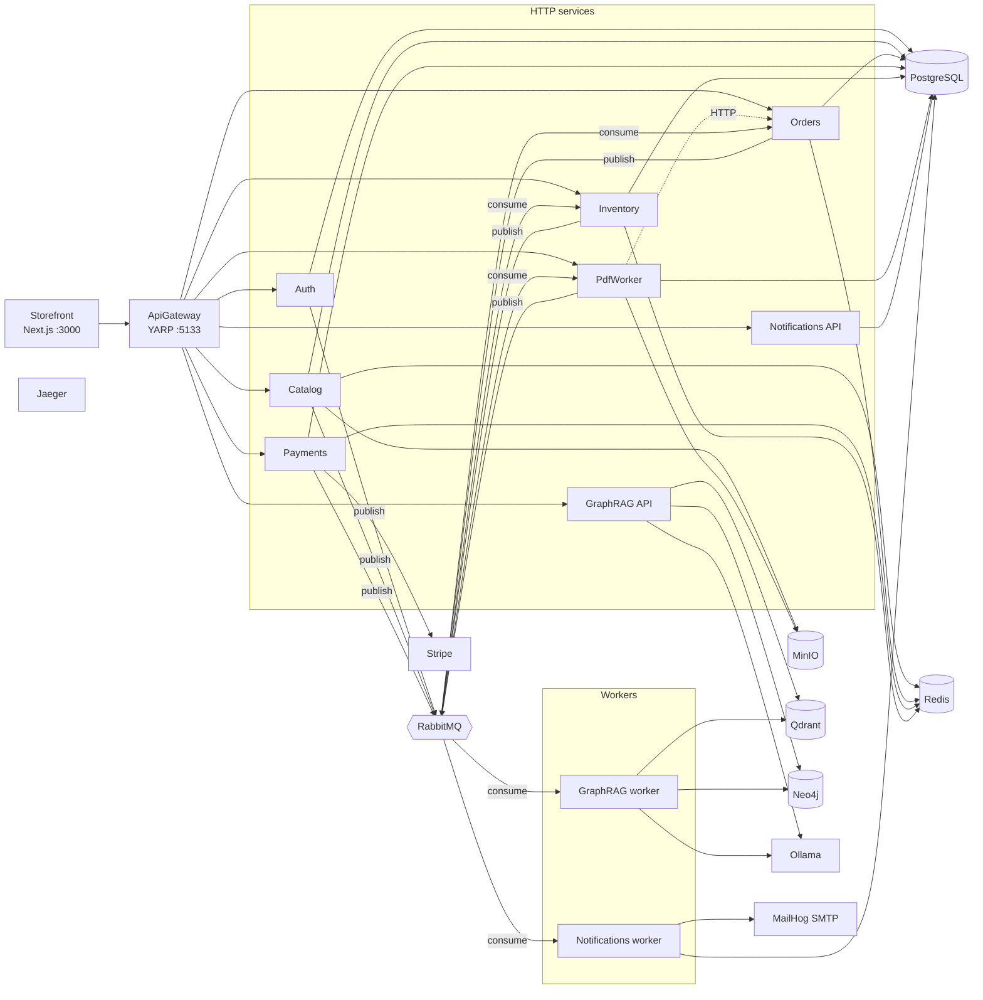
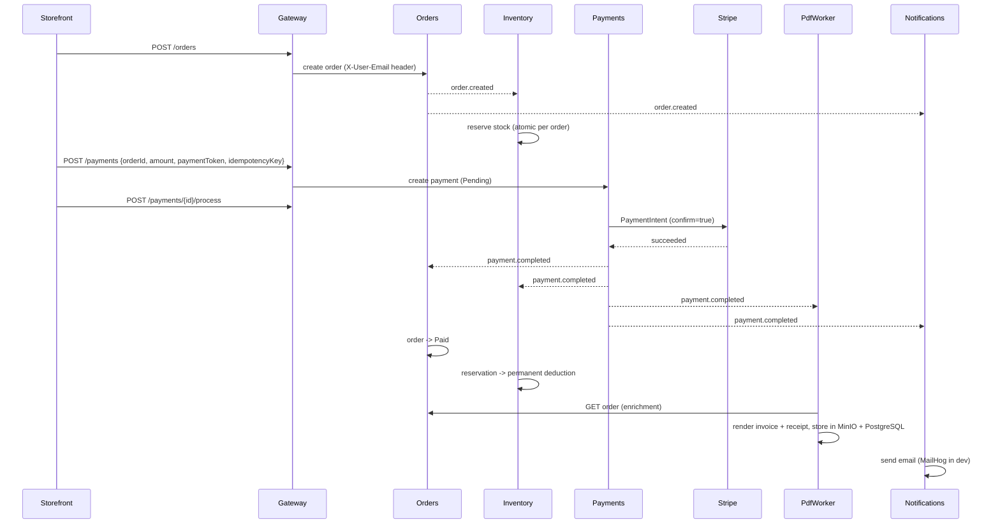

# 3D Printing Store - Microservices E-Commerce

A proof-of-concept e-commerce platform for a **3D-printing store** (printable models, filaments and accessories), built as a set of independently deployable microservices. It runs entirely on a local machine with Docker Compose.

The platform demonstrates:

- Service decomposition with a **database per service**
- An **API gateway** (YARP) in front of every HTTP service
- **Event-driven integration** over RabbitMQ (topic exchanges)
- Order -> payment (Stripe) -> inventory -> documents -> notifications **choreography**
- **GraphRAG** product search, recommendations and chat (Qdrant + Neo4j + local LLMs via Ollama)
- PDF invoice/receipt/credit-note generation, email notifications, object storage, caching and distributed tracing

> Each project has its own `README.md` with full detail (endpoints, event payloads, database schemas, configuration). This document is the map: how the pieces fit together and how to run them.

---

## Table of contents

1. [Architecture at a glance](#architecture-at-a-glance)
2. [Projects](#projects)
3. [Tech stack](#tech-stack)
4. [Event bus](#event-bus)
5. [Business flows](#business-flows)
6. [Data stores](#data-stores)
7. [Infrastructure and ports](#infrastructure-and-ports)
8. [Running the system](#running-the-system)
9. [Repository layout](#repository-layout)
10. [Cross-cutting conventions](#cross-cutting-conventions)
11. [Known issues and gaps](#known-issues-and-gaps)

---

## Architecture at a glance



Every .NET service and both Python services export OpenTelemetry traces to Jaeger.

Request path: `Browser -> Storefront (Next.js) -> ApiGateway -> service`. The gateway validates nothing at the route level today (see [Known issues](#known-issues-and-gaps)); it adds a correlation id and forwards `X-User-Id` / `X-User-Email` headers extracted from a valid JWT.

---

## Projects

| Project | Role | Tech | Host port (compose) | Datastores | README |
|---|---|---|---|---|---|
| **[ApiGateway](ApiGateway/README.md)** | Single entry point; reverse proxy, CORS, correlation id, JWT claim forwarding | .NET 10, YARP | `5133` | none | [link](ApiGateway/README.md) |
| **[Auth](Auth/README.md)** | Registration, login, Google login, JWT + rotating refresh tokens | .NET 10, EF Core, MediatR | `5132` | PostgreSQL | [link](Auth/README.md) |
| **[Catalog](Catalog/README.md)** | Products, images, attributes, relations; publishes catalog events | .NET 10, EF Core, MediatR | `5134` | PostgreSQL, Redis, MinIO | [link](Catalog/README.md) |
| **[Orders](Orders/README.md)** | Order lifecycle; reacts to payment results | .NET 10, EF Core, MediatR | `5136` | PostgreSQL, Redis | [link](Orders/README.md) |
| **[Payments](Payments/README.md)** | Payment lifecycle, Stripe charges and refunds | .NET 10, EF Core, MediatR, Stripe.net | `5135` | PostgreSQL, Redis | [link](Payments/README.md) |
| **[Inventory](Inventory/README.md)** | Stock levels, reservations, expiry; reacts to order/payment events | .NET 10, EF Core, MediatR | `5137` | PostgreSQL, Redis | [link](Inventory/README.md) |
| **[PdfWorker](PdfWorker/README.md)** | Generates invoices, receipts, credit notes (PDF) from payment events | .NET 10, QuestPDF | `5140` | PostgreSQL, MinIO | [link](PdfWorker/README.md) |
| **[Notifications](Notifications/README.md)** | Email notifications from platform events + history API (API and worker) | Python, FastAPI, Jinja2, SQLAlchemy/Alembic | `8200` (API) | PostgreSQL | [link](Notifications/README.md) |
| **[GraphRAG](GraphRAG/README.md)** | Hybrid vector + graph search, recommendations, chat (API and worker) | Python, FastAPI, Qdrant, Neo4j, Ollama | `8100` (API) | Qdrant, Neo4j | [link](GraphRAG/README.md) |
| **[Storefront](Storefront/README.md)** | Customer shop and staff admin UI | Next.js, React, TypeScript, Tailwind, shadcn/ui | `3000` (dev) | none | [link](Storefront/README.md) |

Supporting folders: [`docker/`](docker) (compose stack and env template) and [`scripts/`](scripts) (`seed-dev-data.py`: seeds products, stock, orders and payments through the gateway).

### Gateway routes

| Public path | Downstream |
|---|---|
| `/auth/**` | Auth |
| `/products/**` | Catalog |
| `/orders/**` | Orders |
| `/payments/**` | Payments |
| `/inventory/**` | Inventory |
| `/documents/**` | PdfWorker |
| `/notifications/**` | Notifications API |
| `/graphrag/**` | GraphRAG API (prefix `/graphrag` is stripped) |
| `GET /health` | The gateway itself |

### Internal structure of the .NET services

Auth, Catalog, Orders, Payments, Inventory and PdfWorker follow the same Clean Architecture / CQRS layout:

```text
<Service>/
  <Service>.sln
  <Service>/            API host: minimal-API endpoints, middleware, Program.cs, Dockerfile
  Application/          MediatR commands/queries/handlers, DTOs, abstractions
  Domain/               entities, enums, domain exceptions (rich domain model)
  Infrastructure/       EF Core, Redis, RabbitMQ, external clients, background jobs, OpenTelemetry
  Contracts/            integration-event classes published to RabbitMQ
  UnitTests/            xUnit unit tests
  IntegrationTests/     Testcontainers-based tests (need Docker)
```

The two Python services (GraphRAG, Notifications) use a FastAPI app plus a separate RabbitMQ consumer process, selected by `SERVICE_MODE=api|worker` in their Docker entrypoint.

---

## Tech stack

| Concern | Technology |
|---|---|
| Backend services | .NET 10, ASP.NET Core minimal APIs, MediatR (CQRS), EF Core + Npgsql |
| Python services | Python, FastAPI, Pydantic, aio-pika, Jinja2, SQLAlchemy + Alembic (Notifications), structlog |
| API gateway | YARP reverse proxy, JWT bearer validation, CORS |
| Frontend | Next.js (App Router), React 19, TypeScript, Tailwind CSS 4, shadcn/ui, TanStack Query, Auth.js (next-auth v5) |
| Relational DB | PostgreSQL 17 (one database per service) |
| Cache | Redis |
| Messaging | RabbitMQ (topic exchanges, JSON payloads) |
| Object storage | MinIO (S3-compatible): product images, generated PDFs |
| Vector DB | Qdrant (dense product embeddings) |
| Graph DB | Neo4j (product, category, material, printer, attribute graph) |
| LLM / embeddings | Ollama (local): `bge-m3` embeddings, `gemma3:4b` and `gemma3:12b` generation; `BAAI/bge-reranker-v2-m3` reranker runs in-process via sentence-transformers |
| Payments | Stripe (PaymentIntents, server-side confirmation) |
| PDF | QuestPDF |
| Email (dev) | MailHog (SMTP capture) |
| Observability | OpenTelemetry -> Jaeger (traces), correlation id header across services |
| Authentication | JWT (HS256) access tokens + hashed rotating refresh tokens; Google ID-token login |
| Testing | xUnit, Moq, Testcontainers (.NET); pytest (Python); Playwright is installed in Storefront (no tests yet) |

---

## Event bus

All services share one RabbitMQ broker. Every exchange is a **topic** exchange carrying JSON. Services publish **PascalCase** JSON (the .NET default); consumers must read it case-insensitively (Notifications normalizes automatically).

| Exchange | Published by | Routing keys |
|---|---|---|
| `ecommerce.events` | Auth | `user.registered`, `user.logged_in` |
| `catalog-exchange` | Catalog | `product.created`, `product.updated`, `product.deleted`, `product.image.uploaded`, `product.image.deleted`, `product.attribute.added`, `product.attribute.deleted`, `product.relation.added`, `product.relation.deleted` |
| `orders-exchange` | Orders | `order.created`, `order.paid`, `order.cancelled`, `order.payment_failed` |
| `payments-exchange` | Payments | `payment.created`, `payment.completed`, `payment.failed`, `payment.refunded`, `payment.cancelled` |
| `inventory-exchange` | Inventory | `inventory.reserved`, `inventory.released`, `inventory.updated`, `inventory.depleted` |
| `documents-exchange` | PdfWorker | `document.generated`, `document.generation.failed` |
| `notifications-dlx` | Notifications | dead-lettered messages when SMTP retries run out (queue `notifications.dlq`) |

### Who consumes what

| Consumer | Queue(s) | Exchange -> routing keys | Effect |
|---|---|---|---|
| **Orders** | `orders.payment-completed`, `orders.payment-failed` | `payments-exchange` -> `payment.completed`, `payment.failed` | Marks order Paid / publishes `order.payment_failed` |
| **Inventory** | `inventory.orders.created`, `inventory.orders.cancelled`, `inventory.payments.completed`, `inventory.payments.failed`, ... | `orders-exchange` -> `order.created`, `order.cancelled`; `payments-exchange` -> `payment.completed`, `payment.failed`, `payment.cancelled` | Reserve, release, or deduct stock |
| **PdfWorker** | `pdf-worker.payment-completed`, `pdf-worker.payment-refunded` | `payments-exchange` -> `payment.completed`, `payment.refunded` | Invoice + receipt / credit note |
| **Notifications worker** | `notifications.events` | `ecommerce.events` -> `user.registered`; `orders-exchange` -> `order.created`, `order.cancelled`, `order.shipped`, `order.delivered`, `order.payment.failed`; `payments-exchange` -> `payment.completed`, `payment.failed`, `payment.cancelled`, `payment.refunded`; `inventory-exchange` -> `inventory.depleted` | Customer / operator emails |
| **GraphRAG worker** | `graphrag-ingestion` | `catalog-exchange` -> `product.created`, `product.updated`, `product.deleted`, `product.relation.added/deleted`, `product.attribute.added/deleted` | Keeps Qdrant and Neo4j in sync |

Not consumed by anyone yet: `user.logged_in`, `payment.created`, `order.paid`, `inventory.reserved/released/updated`, `document.*`, `product.image.*`.

Exact payload fields and consumer behavior (retries, acks, idempotency) are documented in each service README.

---

## Business flows

### Place and pay for an order



Failure paths: `payment.failed` / `payment.cancelled` (including automatic expiry of Pending payments after 30 minutes) release the stock reservation; Orders publishes `order.payment_failed`; `order.cancelled` releases reservations. Refunds (`POST /payments/{id}/refund`) emit `payment.refunded`, which makes PdfWorker issue a credit note and Notifications email the customer.

### Catalog to search index

```text
Catalog (PostgreSQL + MinIO)  --product.* events-->  GraphRAG worker
                                                       |-- embeds text with bge-m3 (Ollama) -> Qdrant
                                                       `-- upserts nodes/relationships        -> Neo4j
Storefront search / chat / recommendations -> /graphrag/api/{search,chat,recommend}
   -> intent -> query rewrite -> Qdrant search + Neo4j expansion -> rerank -> (LLM answer)
```

### Authentication

1. Storefront calls `POST /auth/register`, `POST /auth/login` or `POST /auth/google`.
2. Auth returns a 60-minute JWT access token and a 7-day refresh token (stored hashed, rotated on every use, token-family revocation on reuse).
3. Storefront (Auth.js) keeps the session and sends `Authorization: Bearer <jwt>` through the gateway; the gateway forwards `X-User-Id` and `X-User-Email`, which Orders/Payments use to resolve the recipient email for notifications.

---

## Data stores

| Store | Used by | What is stored |
|---|---|---|
| **PostgreSQL** (single server, one DB per service) | Auth (`ecommerce`), Catalog (`catalog`), Orders (`orders`), Payments (`payments`), Inventory (`inventory`), PdfWorker (`pdfworker`), Notifications (`notifications`) | Relational aggregates, enums mostly as integers, idempotency/processed-event tables |
| **Redis** | Catalog, Orders, Payments, Inventory | Read-through JSON caches with short TTLs (1-10 min) |
| **MinIO** | Catalog (`products` bucket), PdfWorker (`documents` bucket) | Product images; generated PDFs |
| **Qdrant** | GraphRAG | Collection `products`: 1024-dim cosine dense vectors + payload used for filtering |
| **Neo4j** | GraphRAG | Product / Category / Material / Printer / Attribute nodes and typed relationships |

Table-level and key-level details are in the owning service's README.

---

## Infrastructure and ports

All ports are configurable in `docker/.env` (template: `docker/template.env`).

| Component | Host port | URL / note |
|---|---|---|
| API Gateway | `5133` | http://localhost:5133 |
| Auth | `5132` | direct access, bypasses the gateway |
| Catalog | `5134` | |
| Payments | `5135` | |
| Orders | `5136` | |
| Inventory | `5137` | |
| PdfWorker | `5140` | |
| GraphRAG API | `8100` | |
| Notifications API | `8200` | |
| Storefront (dev) | `3000` | `npm run dev` |
| PostgreSQL | `5433` | container port 5432 |
| pgAdmin | `5050` | http://localhost:5050 |
| Redis / RedisInsight | `6379` / `5540` | http://localhost:5540 |
| RabbitMQ / management UI | `5672` / `15672` | http://localhost:15672 |
| MinIO API / console | `9000` / `9001` | http://localhost:9001 |
| Qdrant HTTP / (gRPC) | `6333` / `6334` | dashboard: http://localhost:6333/dashboard |
| Neo4j HTTP / Bolt | `7474` / `7687` | http://localhost:7474 |
| Ollama | `11435` | container port 11434 |
| Jaeger UI / OTLP gRPC / OTLP HTTP | `16686` / `4317` / `4318` | http://localhost:16686 |
| MailHog UI / SMTP | `8025` / `1025` | http://localhost:8025 |

---

## Running the system

### Prerequisites

- Docker Desktop (Compose v2)
- .NET 10 SDK (only for native runs / tests)
- Node.js (for the Storefront)
- Python (only for native runs of GraphRAG / Notifications, and the seed script)
- A Stripe **test** secret key (`sk_test_...`) if you want to take payments

### 1. Configure environment

```bash
cd docker
cp template.env .env
```

Fill in the blank values in `.env`: `NEO4J_USER` / `NEO4J_PASSWORD`, `RABBITMQ_USER` / `RABBITMQ_PASSWORD`, `MINIO_ROOT_USER` / `MINIO_ROOT_PASSWORD`, and `STRIPE_SECRET_KEY`. `docker/.env` is git-ignored; never commit real keys.

#### Development admin account

The admin area (`/admin/*`) is only open to the `Admin` role, and nobody can become an admin through the public register page. For local development, `scripts/seed-dev-data.py` creates the admin for you: it registers `admin@store.local` through the normal register endpoint, then promotes it to `Admin` with one `UPDATE` inside the `postgres` container (so the `docker` CLI must be available). It is safe to re-run.

- Default credentials: `admin@store.local` / `AdminShop2026!`. Change them with `--admin-email` / `--admin-password`.
- If your Postgres container, user or database differ from the defaults, pass `--postgres-container`, `--postgres-user`, `--postgres-db`.
- This account is **development-only**. In any other environment administrators must be provisioned outside the application.
- Sign in at `/login` with those credentials, then open `/admin/products`.
### 2. Start the stack
The whole backend, including Ollama, is defined in [`docker/docker-compose.yml`](docker/docker-compose.yml).

**Ollama: GPU or CPU.** Ollama runs on CPU + RAM by default. To use an NVIDIA CUDA GPU, start the stack with the GPU override. The helper scripts detect a usable NVIDIA GPU (`nvidia-smi` plus the NVIDIA runtime in Docker) and add the override only when it is present, so the same command works on machines with and without a GPU:

```powershell
cd docker
./up.ps1                 # PowerShell: up -d --build, GPU auto-detected
./up.ps1 up -d postgres rabbitmq redis minio jaeger   # any compose arguments are passed through
```

```bash
cd docker
./up.sh                  # bash equivalent
```

Manual equivalents:

```bash
docker compose up -d --build                                              # CPU
docker compose -f docker-compose.yml -f docker-compose.gpu.yml up -d --build   # NVIDIA GPU
```

GPU prerequisites: NVIDIA driver, and the NVIDIA Container Toolkit on Linux (on Windows: Docker Desktop with the WSL2 backend). The reservation lives in [`docker/docker-compose.gpu.yml`](docker/docker-compose.gpu.yml) because Compose cannot declare an optional device: putting it in the base file would make `docker compose up` fail on hosts without the NVIDIA runtime.

### 3. Pull the Ollama models (once)

```bash
docker exec ollama ollama pull bge-m3
docker exec ollama ollama pull gemma3:4b
docker exec ollama ollama pull gemma3:12b
```

The reranker (`BAAI/bge-reranker-v2-m3`) is downloaded from Hugging Face by the GraphRAG process, not by Ollama.

### 4. Run database migrations where needed

Most .NET services apply EF migrations automatically when `ASPNETCORE_ENVIRONMENT=Development` (set in compose). Notifications uses Alembic and needs `alembic upgrade head` run once (see its README).

### 5. Seed demo data (optional)

```bash
pip install httpx
python scripts/seed-dev-data.py                  # uses http://localhost:5133
python scripts/seed-dev-data.py --skip-payments  # catalog + inventory + orders only
```

### 6. Start the Storefront

```bash
cd Storefront
npm install
# .env.local - the Storefront defaults to http://localhost:8080, but the compose gateway is on 5133:
#   NEXT_PUBLIC_API_GATEWAY_URL=http://localhost:5133
#   AUTH_SECRET=<random string>
npm run dev            # http://localhost:3000
```

### Running a single service natively

Start the infrastructure it needs (for example `docker compose up -d postgres rabbitmq redis minio jaeger`) and then:

```bash
dotnet run --project <Service>/<Service>      # e.g. Orders/Orders
```

Note that `appsettings.Development.json` files point at `localhost` and the host-published PostgreSQL port `5433`.

### Tests

```bash
dotnet test <Service>/<Service>.sln     # unit + integration (integration needs Docker for Testcontainers)
```

Python services: `pytest` inside `GraphRAG/` or `Notifications/`. ApiGateway integration tests expect pre-built `ecommerce-infra-*` images. See each README for specifics.

---

## Repository layout

```text
Microservices-E-Commerce/
|-- ApiGateway/       YARP gateway (.NET)
|-- Auth/             identity service (.NET)
|-- Catalog/          product catalog (.NET)
|-- Orders/           order service (.NET)
|-- Payments/         payment service + Stripe (.NET)
|-- Inventory/        stock + reservations (.NET)
|-- PdfWorker/        PDF documents worker (.NET)
|-- Notifications/    email notifications API + worker (Python)
|-- GraphRAG/         search / recommendations / chat API + worker (Python)
|-- Storefront/       customer + admin web app (Next.js)
|-- docker/           docker-compose.yml, docker-compose.gpu.yml, up.ps1, up.sh, template.env, postgres-init/
|-- scripts/          seed-dev-data.py
`-- README.md
```

---

## Cross-cutting conventions

- **Database per service**; no shared tables. Cross-service data flows through events or explicit HTTP calls (PdfWorker enriches documents by calling Orders).
- **Idempotency**: Payments requires an `IdempotencyKey` (unique index, also forwarded to Stripe); PdfWorker derives deterministic idempotency keys per document; Inventory and Notifications record processed events.
- **Correlation id**: the gateway and every service honor `X-Correlation-Id` and include it in logs/traces.
- **Recipient email**: Orders and Payments embed `RecipientEmail` in events (from the `X-User-Email` header set by the gateway, or JWT claims) so Notifications does not need a user lookup.
- **Roles** defined by Auth: `Admin` and `Customer` (anything else is treated as `Customer`; only `Admin` can use the staff area).
- **Observability**: OpenTelemetry traces to Jaeger (http://localhost:16686). Health endpoints are exposed as `GET /health` on each service.
- **Errors**: services use exception middleware returning a consistent JSON error body.

---

## Known issues and gaps

Collected while documenting each project (details are in the service READMEs). None of these are fixed by the documentation work.

**Security**
- The gateway does not enforce authentication or authorization on any route, and no downstream service checks tokens or roles. Rate limiters are defined (`auth-strict`, `global`) but not attached to routes.
- The gateway does not strip inbound `X-User-*` headers, so a client can spoof them.
- Development JWT secret and RabbitMQ `guest/guest` defaults are committed in appsettings files.

**Integration**
- Orders publishes `order.payment_failed` but Notifications binds `order.payment.failed`: the "order payment failed" email is never triggered.
- Orders defines `OrderProcessing/Shipped/Delivered` but nothing publishes them, so orders never leave `Paid` (except to `Cancelled`); Notifications' `order.shipped` / `order.delivered` handlers therefore never fire.
- Catalog products stay in `Draft` (nothing publishes them), Catalog `PrintSettings`/`Dimensions` are not persisted due to private setters, and `product.image.uploaded` carries an empty `ImageId`.
- Several consumers (Orders, Inventory, PdfWorker, Notifications on unexpected errors) requeue failed messages indefinitely without a dead-letter queue; GraphRAG acks failures without retry.
- Stripe is not wired into the Storefront checkout: orders can be created in the UI but the card form is not connected. Stripe webhooks and 3-D Secure are not implemented (3DS `requires_action` marks the payment `Failed`).

**Service-specific**
- Auth: business errors surface as HTTP 500; a new Google user probably fails on the `NOT NULL` password hash column.
- Catalog: when started by compose in `Development` mode, `appsettings.Development.json` (localhost) overrides the container hostnames; only MinIO keys are overridden by compose.
- GraphRAG: sparse vectors are empty with the default Ollama embedding provider (search is effectively dense-only); the graph connectivity score is zeroed during merge; the worker emits no traces.
- PdfWorker: the EF migration/snapshot do not match the current `DocumentConfiguration`; there is no PDF download endpoint (the Storefront downloads from MinIO).
- Storefront: the PDF proxy route hard-codes MinIO at `http://localhost:9000`.

---

## License

See [LICENSE](LICENSE).
